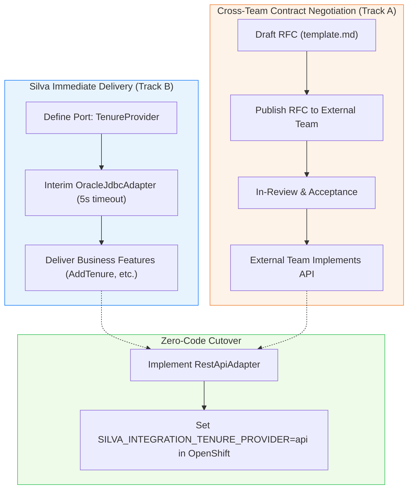

# External Systems Integration & Anti-Corruption Layer (ACL) Patterns

## Overview

Silva interacts with external legacy databases and external services (e.g., FTA for Cut Blocks/Tenures, Forest Client API, Org Units). To prevent coupling Silva's domain to external schemas or column names, all external integrations follow the **Ports and Adapters (Hexagonal)** pattern with an **Anti-Corruption Layer (ACL)**.

---

## Core Rules for Agents

1. **Never inject external repositories or entities directly into Silva domain services:**
   - ❌ **WRONG:** Injecting `CutBlockPostgresRepository` or `CutBlockOracleRepository` into `TenureValidationService`.
   - ✅ **RIGHT:** Injecting `TenureProvider` interface into `TenureValidationService`.

2. **Define functional contracts, not CRUD table mirrors:**
   - ❌ **WRONG:** `CutBlockEntity findById(Long cbSkey)` (leaks external primary key and table structure).
   - ✅ **RIGHT:** `ExternalCutBlockDetails verifyCutBlock(fileId, cuttingPermit, cutBlock, clientNumber)` (expresses business intent and returns clean Silva domain record; internal availability is checked in Silva).

3. **Per-domain provider switching via Delegating Providers (GraalVM Native compatible):**
   - In GraalVM native image builds, `@ConditionalOnProperty` is evaluated at build time (AOT) and prunes inactive beans.
   - To allow switching via OpenShift environment variables (`silva.integrations.<domain>.provider=oracle|api|mock`) without rebuilding images or exploding Docker build arguments, register all adapters as Spring components and route calls via a `@Primary` delegating provider that reads `Environment.getProperty(...)` at runtime.

4. **External Oracle queries use `NamedParameterJdbcTemplate`:**
   - Do NOT create JPA `@Entity` classes for external tables.
   - Use `NamedParameterJdbcTemplate externalOracleJdbcTemplate` with raw SQL and explicit row mappers inside the Oracle adapter.

5. **Provide a Mock adapter for offline testing:**
   - Every `XxxProvider` must have a corresponding `MockXxxAdapter` component (e.g. `@Component("mockTenureAdapter")`).

---

## 6-Step Integration Pattern

When adding or refactoring an external dependency:

### Step 1: Create Domain Records / Value Objects in `common/dto/`
Define immutable records representing the external data Silva actually needs.
```java
package ca.bc.gov.restapi.results.common.dto;

public record ExternalCutBlockDetails(
    boolean exists,
    Long cbSkey,
    boolean clientIsLicensee,
    String timberMark,
    String status
) {
  public static ExternalCutBlockDetails notFound() {
    return new ExternalCutBlockDetails(false, null, false, null, null);
  }
}
```

### Step 2: Define Provider Interface (Port) in `common/provider/`
Define the functional contract. Note: Opening allocations belong to Silva's persistence store (`silva.cut_block_open_admin`) and are validated in Silva domain services.
```java
package ca.bc.gov.restapi.results.common.provider;

public interface TenureProvider {
  ExternalCutBlockDetails verifyCutBlock(
      String forestFileId,
      String cuttingPermitId,
      String cutBlockId,
      String clientNumber);
}
```

### Step 3: Implement Oracle JDBC Adapter in `oracle/provider/`
Encapsulate all external table queries, column names, and joins.
```java
@Component("oracleTenureJdbcAdapter")
@RequiredArgsConstructor
public class OracleTenureJdbcAdapter implements TenureProvider {
  private final NamedParameterJdbcTemplate externalOracleJdbcTemplate;

  @Override
  public ExternalCutBlockDetails verifyCutBlock(...) {
    // Execute SQL query against THE.CUT_BLOCK, etc.
  }
}
```

### Step 4: Implement Mock Adapter in `common/provider/mock/`
Allow local dev and unit/integration testing without Oracle credentials.
```java
@Component("mockTenureAdapter")
public class MockTenureAdapter implements TenureProvider {
  @Override
  public ExternalCutBlockDetails verifyCutBlock(...) {
    return new ExternalCutBlockDetails(true, 1001L, true, "47/12K", "ACT");
  }
}
```

### Step 5: Implement Delegating Provider in `common/provider/`
Enables OpenShift runtime switching in GraalVM native image without build arguments.
```java
@Component
@Primary
@RequiredArgsConstructor
public class DelegatingTenureProvider implements TenureProvider {
  private final Map<String, TenureProvider> adapters;
  private final Environment env;

  @Override
  public ExternalCutBlockDetails verifyCutBlock(String fileId, String permitId, String blockId, String clientNumber) {
    String provider = env.getProperty("silva.integrations.tenure.provider", "oracle");
    TenureProvider delegate = adapters.get(provider.toLowerCase() + "TenureAdapter");
    return delegate.verifyCutBlock(fileId, permitId, blockId, clientNumber);
  }
}
```

### Step 6: Consume in Silva Domain Service
Inject the interface, not a concrete class or repository.
```java
@Service
@RequiredArgsConstructor
public class TenureValidationService {
  private final TenureProvider tenureProvider;
  private final CutBlockOpenAdminRepository cboaRepository;

  public TenureValidationResponseDto validateTenures(List<TenureRequestDto> tenures, String clientNumber) {
    for (TenureRequestDto req : tenures) {
      ExternalCutBlockDetails details = tenureProvider.verifyCutBlock(
          req.fileId(), req.cuttingPermit(), req.cutBlock(), clientNumber);
      // Validate Silva-owned opening association against cboaRepository
    }
    return response;
  }
}
```

---

## When an External System Modernizes to REST API

To switch an external dependency from Oracle to a REST API:
1. Implement `RestApiXxxAdapter` implementing `XxxProvider` in `common/provider/` using `RestClient`.
2. Register it as `@Component("restApi<Domain>Adapter")`.
3. Set `SILVA_INTEGRATION_<DOMAIN>_PROVIDER=api` in OpenShift config.
4. **Silva domain services require ZERO code changes.**

---

## Cross-Team Interface RFC Process & Lifecycle

When an external ministry system (e.g. FTA, Forest Client, Org Units) needs to expose a modern interface to Silva, Silva engineers author a formal **Request for Comments (RFC)** to negotiate the contract. This ensures that interfaces are **consumer-driven**—designed to fulfill Silva's specific functional requirements, performance budgets, and data freshness needs, rather than forcing Silva to adapt to arbitrary external endpoint designs or legacy database structures.

The RFC template and registry are maintained in:
- Template: [`docs/architecture/rfc/template.md`](../../../../docs/architecture/rfc/template.md)
- Registry & Index: [`docs/architecture/rfc/README.md`](../../../../docs/architecture/rfc/README.md)

### RFC Lifecycle States

Each RFC document tracks its status using MADR-style YAML frontmatter:

```
  +------------+       +-------------+       +------------+       +---------------+
  |  proposed  | ----> |  in_review  | ----> |  accepted  | ----> |  implemented  |
  +------------+       +-------------+       +------------+       +---------------+
                             |
                             v
                       +------------+
                       |  rejected  |
                       +------------+
```

1. **`proposed`**:
   - The Silva engineering team authors the RFC using [`template.md`](../../../../docs/architecture/rfc/template.md).
   - Specifies Silva's consumer needs, proposed REST endpoints (paths, methods, request/response DTO schemas) or domain event schemas (CloudEvents 1.0), operational SLAs, and security requirements.
   - Silva domain Port (`XxxProvider`) and clean domain records are committed, accompanied by an offline `MockXxxAdapter` and an interim `OracleXxxJdbcAdapter`.
2. **`in_review`**:
   - The RFC is submitted to the external engineering team (e.g. Forest Tenures Administration team) and Product Owner.
   - Both teams review payload schemas, query parameters, error responses (RFC 7807), latency budgets, and security tokens in GitHub pull requests or architecture reviews.
3. **`accepted`**:
   - Both teams formally sign off on the contract, field mapping, operational SLAs, and target delivery milestones.
   - The external team schedules the implementation of the REST API / event publisher in their backlog.
4. **`implemented`**:
   - The external team deploys the API/event stream in staging/production.
   - Silva engineers implement `RestApiXxxAdapter` using Spring `RestClient`, write contract tests using WireMock, and verify against external test environments.
   - The integration is activated in OpenShift via runtime configuration (`SILVA_INTEGRATION_<DOMAIN>_PROVIDER=api`).
5. **`rejected`**:
   - The proposed contract is rejected or superseded by an alternative architecture (e.g. event stream instead of polling REST API).

### How the RFC Process Fits the Dual-Track Architecture

Silva does **not** wait for external systems to finish modernizing before delivering business features. Instead, Silva follows a parallel dual-track approach:



- **Immediate Feature Delivery:** Silva builds the domain port interface, clean domain DTOs, and an interim `OracleXxxJdbcAdapter` to run against the secondary read-only Oracle connection pool. Silva features (e.g. opening creation, tenure validation) ship immediately.
- **Contract Negotiation:** Concurrently, Silva publishes the RFC (e.g. `RFC-001`) to the external team.
- **Seamless Cutover:** When the external API is live, Silva adds the `RestApiXxxAdapter` and toggles the environment variable. Core domain services require zero modifications.

---

## CQRS & Read Model Projections Across External Domains

When building features that interact across Silva and external domain boundaries:
- **Rule of Thumb:**
  - **Commands & Validations:** Always go through the `XxxProvider` port to verify against the external authoritative system of record before committing changes.
  - **Queries, Searches & Composite Views:** Always execute locally against Silva's PostgreSQL read projections and indexed tables.
- **Never Query External REST APIs in High-Traffic Read Paths:**
  - Do NOT query external APIs inside SQL queries, looping record sets, search endpoints, or spatial GIS operations ($N+1$ latency and rate-limit hazards).
  - Use local read projections or cached read models for multi-record filtering, dashboards, spatial overlays, and exports.
