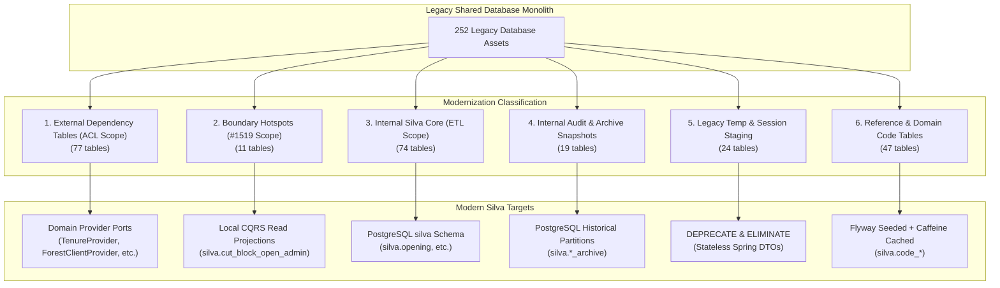
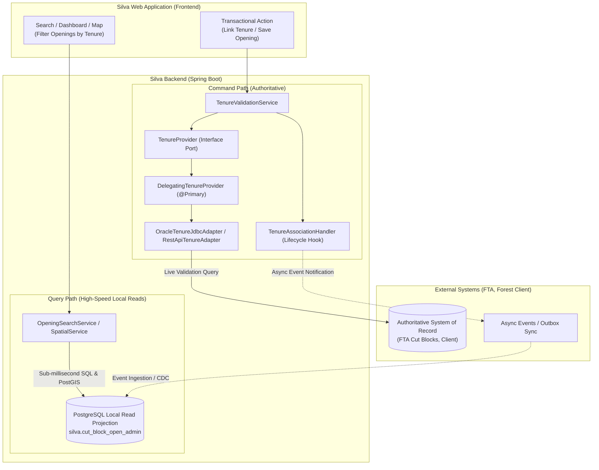

# Silva Data Integration & Architecture Matrix

## Overview

Silva modernizes the British Columbia Ministry of Forests **RESULTS** (Reporting Silviculture Updates and Land status Tracking System) application. In its legacy architecture, RESULTS operated within a shared monolithic database where boundaries between systems were tightly coupled at the SQL schema level. RESULTS directly queried tables owned by external ministry systems (e.g., Forest Tenures Administration / FTA, Forest Client, SPAR, and Corporate Organization Units), while maintaining its own silviculture domain records, reference codes, and session staging tables.

To systematically decouple Silva into a modern, cloud-native architecture running on PostgreSQL (`server.primary-db=postgres`), all database dependencies are cataloged into an authoritative, versioned integration matrix.

As established in **[ADR-001](./adr/ADR-001-external-systems-anti-corruption-layer.md)** and the **[External Systems Integration Spec](./external-systems-integration-spec.md)**, Silva applies:
1. **Ports and Adapters (Hexagonal Architecture) with an Anti-Corruption Layer (ACL):** External systems are accessed solely through domain provider ports (`*Provider`) and swappable adapters (Secondary Oracle JDBC, future REST APIs, or offline Mocks).
2. **PostgreSQL Migration (`silva` schema):** Core internal silviculture entities are migrated to PostgreSQL and managed by Spring Data JPA repositories.
3. **Command Query Responsibility Segregation (CQRS):** Live domain validations call authoritative provider ports on the command path, while multi-criteria searches, dashboards, and spatial GIS overlays execute against indexed local read projections in PostgreSQL.
4. **Flyway Migrations & In-Memory Caching:** Reference code tables are seeded in PostgreSQL and cached in-memory with Caffeine.
5. **Deprecation of Legacy Temporary Tables:** Legacy session and staging tables are eliminated in favor of stateless Spring DTOs and PostgreSQL ACID transactions.

---

## 1. Inventory & Architectural Classification Summary

All 252 database assets touched by RESULTS have been categorized into distinct architectural scopes:

| Scope Category | Asset Count | Target Architecture | Modernization Destination |
| :--- | :---: | :--- | :--- |
| **External Dependency Tables (ACL Scope)** | **77** | Ports & Adapters (ACL) | Domain Provider Ports (`*Provider`) in `ca.bc.gov.restapi.results.common.provider` |
| **Boundary Hotspots & Shared Tables** | **11** | CQRS Read Projections & Hooks | Local PostgreSQL read projections (`silva.cut_block_open_admin`) + lifecycle hooks; reviewed in **[#1519](https://github.com/bcgov/nr-silva/issues/1519)** |
| **Internal Silva Core Tables (ETL Scope)** | **74** | PostgreSQL Schema | Migrated to PostgreSQL `silva` schema via ETL module; Spring Data JPA |
| **Internal Audit, Archive & History Tables** | **19** | Partitioned / Event History | PostgreSQL append-only audit tables and historical milestone archive tables |
| **Legacy Temp, Session & Staging Tables** | **24** | **Deprecate / Eliminate** | Eliminated; replaced by stateless HTTP sessions, React Query, and in-memory DTOs |
| **Reference & Domain Code Tables** | **47** | Flyway Seeding & Caching | Seeded via Flyway migrations into PostgreSQL `silva.code_*`; Caffeine cached (`ttl = 60m`) |
| **Total Reconciled Assets** | **252** | | |

---

## 2. CQRS Read Projections & Modern Architecture

Silva separates operational commands from read-heavy cross-domain queries:

- **The Cross-Network Join & $N+1$ Trap:** Directly joining remote external REST APIs across hundreds or thousands of records introduces severe latency and risks external rate-limit exhaustion. Furthermore, spatial GIS queries (e.g. PostGIS `ST_Intersects` between opening polygons and cut block geometries) **cannot be executed over remote REST APIs**.
- **The Division of Labor:**
  1. **Command Path (Authoritative Validation):** State-changing actions and validation checks query the live domain port (`*Provider`, e.g. `TenureProvider.verifyCutBlock`, `ForestClientProvider.getClient`) to enforce business rules against the authoritative system of record.
  2. **Query Path (High-Performance Local Reads):** All multi-entity searches, composite dashboards, spatial GIS overlays, and reports execute 100% locally against indexed PostgreSQL tables and read model projections (`silva.cut_block_open_admin`, `silva.opening_search_vw`).

---

## 3. External Dependency Tables (Anti-Corruption Layer Scope)

These tables belong to external ministry systems. Under the Anti-Corruption Layer pattern, Silva **never queries these tables directly inside core domain logic**. Instead, each domain group maps to a dedicated Provider Port with clean, immutable Value Objects (DTOs) and swappable adapters.

### 3.1 Forest Tenures Administration (FTA)

- **Target Provider Port:** `TenureProvider` (`ca.bc.gov.restapi.results.common.provider.TenureProvider`)
- **Domain Records / DTOs:** `ExternalCutBlockDetails`, `ExternalTenureSummary` (in `common.dto`)
- **Adapters:** `OracleTenureJdbcAdapter` (secondary read-only pool), `RestApiTenureAdapter` (future FTA REST API), `MockTenureAdapter`
- **Modernization Strategy:** Queried via lightweight `NamedParameterJdbcTemplate` in `primary-db=postgres` mode. Decoupled behind `TenureProvider` port. Future transition to FTA REST API (RFC-001).

| Table Name | Forestry Domain Description | Integration Context |
| :--- | :--- | :--- |
| `BLOCK_STATUS_CODE` | Cut block operational status lookup (e.g., Active, Complete, Logged) | Cut block eligibility and operational status check |
| `CORP_CAPTURE_METHOD` | Spatial coordinate capture methodology for tenure mapping | Spatial coordinate capture metadata |
| `CUT_BLOCK_AUDIT` | Historical audit log of cut block modifications in FTA | Cut block modification history |
| `CUT_BLOCK_CLIENT` | Cut block licensee client and billing association | Licensee client validation against cut block |
| `CUT_BLOCK_GEOM` | Spatial polygon geometry and boundary mapping for harvested cut blocks | Spatial boundary and cut block mapping |
| `DIST_TENR_DEFLT` | Natural resource district default tenure administration parameters | Default district administrative parameters |
| `FILE_CLIENT_TYPE_CODE` | Client role on tenure file (e.g., Agreement Holder, Billing Agent) | Client role identification on tenure agreements |
| `FILE_SOURCE_CODE` | Origin source of tenure file record (e.g., Electronic, Manual) | Tenure file origin tracking |
| `FILE_STATUS_CODE` | Operational lifecycle status of timber tenure files | Tenure agreement status verification |
| `FILE_TYPE_CODE` | Classification of timber tenure files (e.g., Forest Licence, TFL) | Tenure license type classification |
| `FOREST_FILE_CLIENT` | Tenure agreement holder and licensee client links | Agreement holder and licensee identification |
| `FOREST_MGMT_UNIT` | Forest management unit definitions and administrative boundaries | Administrative management unit filtering |
| `FOR_CLIENT_LINK` | Cross-reference linkage between forestry tenure files and client records | Tenure-to-client linkage resolution |
| `HARVESTING_AUTHORITY` | Harvesting authority permits and license approvals | Harvesting permit authority check |
| `HARVESTING_HAULING_XREF` | Linkage between harvesting permits and timber hauling authorities | Permit-to-hauling authority linkage |
| `HARVEST_SALE` | Timber harvest sale authorization and competitive bidding records | Timber sale harvesting validation |
| `HAULING_AUTHORITY` | Timber transportation and log hauling authorizations | Hauling authorization verification |
| `MARK_STATUS_CODE` | Timber mark status lookup (e.g., Active, Suspended, Retired) | Timber mark status and validity check |
| `MGMT_UNIT_TYPE_CODE` | Management unit type classifications (e.g., TSA, TFL, Woodlot) | Management unit type resolution |
| `PRIMARY_LAND_INDEX_CODE` | Primary legal land parcel identifier for tenured lands | Legal land identification |
| `PRIVATE_MARK_CERTIFICATE` | Private timber mark registration certificates and credentials | Private timber mark credential lookup |
| `PRIVATE_MARK_TYPE_CODE` | Classifications of private land timber marks | Private mark category classification |
| `PRMT_AUTHZD_BLK` | Cutting permits authorized for block-level timber harvesting | Authorized cutting permit block verification |
| `PROV_FOREST_USE` | Provincial forest land use authorization records | Provincial land use authority lookup |
| `RANGE_FILE_TYPE_CODE` | Range tenure agreement type classifications | Range tenure classification lookup |
| `RANGE_TENURE_STATUS_CODE` | Operational status of range tenure grazing agreements | Range tenure status check |
| `RECREATION_FILE_STATUS_CODE` | Status lifecycle of recreation site and reserve files | Recreation reserve status check |
| `RECREATION_FILE_TYPE_CODE` | Types of recreation tenure agreements and reserve designations | Recreation agreement classification lookup |
| `SALVAGE_TYPE_CODE` | Timber salvage harvest classifications (e.g., Fire, Beetle, Windthrow) | Salvage operation classification lookup |
| `SECONDARY_LAND_INDEX_CODE` | Secondary legal land index parcel definitions | Secondary land parcel identification |
| `SIL001_TENURE_SEARCH_RESULT` | Legacy session-cached search result table for tenure inquiries | Legacy tenure search cache (replaced by live API/DB) |
| `SIL002_MARK_SEARCH_RESULT` | Legacy session-cached search result table for timber mark inquiries | Legacy timber mark search cache (replaced by live API/DB) |
| `SIL003_CT_BLK_SH_RESULTS` | Legacy session-cached search result table for cut block searches | Legacy cut block search cache (replaced by live API/DB) |
| `TENURE_APPLICATION_TYPE_CODE` | Types of formal applications submitted for forest tenures | Tenure application category lookup |
| `TENURE_FILE_STATUS_CODE` | Status lifecycle codes for tenure file processing | Tenure file lifecycle validation |
| `TENURE_STATUS_CODE` | Overall operational status codes for tenures | Tenure agreement status validation |
| `TIMBER_FILE_TYPE_CODE` | Classification of timber tenure agreements and licenses | Timber agreement category lookup |
| `TIMBER_MARK` | Authoritative timber marks for transport identification and stumpage billing | Timber mark validation for opening association |
| `TSA_NUMBER_CODE` | Timber Supply Area (TSA) administrative numbering codes | Timber Supply Area identification |

### 3.2 Forest Client (CLIENT)

- **Target Provider Port:** `ForestClientProvider` (`ca.bc.gov.restapi.results.common.provider.ForestClientProvider`)
- **Domain Records / DTOs:** `ForestClientDetails`, `ClientLocationDetails` (in `common.dto`)
- **Adapters:** `OracleForestClientJdbcAdapter`, `RestApiForestClientAdapter`, `MockForestClientAdapter`
- **Caching Policy:** In-memory Caffeine cache (`ttl = 10m` for autocomplete queries, `ttl = 60m` for full client profiles)
- **Modernization Strategy:** Authoritative source for client numbers and licensee identity. Consumed via REST API or secondary Oracle pool.

| Table Name | Forestry Domain Description | Integration Context |
| :--- | :--- | :--- |
| `CLIENT_ACRONYM` | Official corporate acronyms, trade names, and abbreviations for licensees | Licensee search, display, and autocomplete |
| `CLIENT_LOCATION` | Mailing addresses, physical locations, and branch office codes per client | Client address and operational location verification |
| `FOREST_CLIENT` | Authoritative master registry for licensee companies, individuals, and client numbers | Client identity, legal name, and licensee verification |
| `V_CLIENT_PUBLIC` | Consolidated public search view combining client status, legal name, and acronym | Public client search and opening header display |

### 3.3 Ministry Organization Units (BCGW / Org Unit)

- **Target Provider Port:** `OrgUnitProvider` (`ca.bc.gov.restapi.results.common.provider.OrgUnitProvider`)
- **Domain Records / DTOs:** `OrgUnitDetails`, `DistrictSummary` (in `common.dto`)
- **Adapters:** `OracleOrgUnitJdbcAdapter`, `RestApiOrgUnitAdapter`, `MockOrgUnitAdapter`
- **Caching Policy:** In-memory Caffeine cache (`ttl = 60m`)
- **Modernization Strategy:** Corporate MOF / BCGW org hierarchy. Static reference queries cached in-memory.

| Table Name | Forestry Domain Description | Integration Context |
| :--- | :--- | :--- |
| `DISTRICT` | Natural resource administrative districts across British Columbia | Natural resource district assignment for openings |
| `REG_DIST_ORGN` | Regional natural resource district organizational hierarchy and rollups | Regional organization rollups and reporting |

### 3.4 Forest Stewardship Plans (FSP)

- **Target Provider Port:** `FspProvider` (`ca.bc.gov.restapi.results.common.provider.FspProvider`)
- **Domain Records / DTOs:** `FspPlanDetails`, `FspRegimeLinkage` (in `common.dto`)
- **Adapters:** `OracleFspJdbcAdapter`, `RestApiFspAdapter`, `MockFspAdapter`
- **Modernization Strategy:** FSP agreement plans and legal terms. Stocking standard regime linkages (`FSP_STANDARDS_REGIME_XREF`) are maintained in local PostgreSQL read projections for sub-millisecond query performance.

| Table Name | Forestry Domain Description | Integration Context |
| :--- | :--- | :--- |
| `FOREST_STEWARDSHIP_PLAN` | Forest Stewardship Plan (FSP) approvals, legal terms, and plan metadata | Forest Stewardship Plan validity and approval check |
| `FSP_AGREEMENT_HOLDER` | Licensees and agreement holders operating under an approved FSP | Licensee compliance with approved FSP |
| `FSP_ORG_UNIT` | Natural resource districts and business units governing an FSP submission | District governing authority for FSP |
| `FSP_STANDARDS_REGIME_XREF` | Cross-reference associating stocking standards regimes with approved FSPs | Stocking regime approval check under FSP |
| `FSP_STATUS_CODE` | Lifecycle status codes for FSP submissions (e.g., Approved, Expired, Draft) | FSP submission lifecycle status verification |

### 3.5 Seed Planning and Registry System (SPAR)

- **Target Provider Port:** `SparProvider` (`ca.bc.gov.restapi.results.common.provider.SparProvider`)
- **Domain Records / DTOs:** `SeedlotDetails`, `SparRequestSummary` (in `common.dto`)
- **Adapters:** `OracleSparJdbcAdapter`, `RestApiSparAdapter`, `MockSparAdapter`
- **Modernization Strategy:** Seed Planning and Registry System. Queried on-demand for planting activity verification and seedlot provenance.

| Table Name | Forestry Domain Description | Integration Context |
| :--- | :--- | :--- |
| `EXCEPTION_CAUSE_CODE` | Justification codes for seed deployment outside transfer guidelines | Seed transfer exception justification lookup |
| `GENETIC_CLASS_CODE` | Genetic class classifications (e.g., Class A orchard, Class B wild stand) | Genetic class classification lookup |
| `INTENDED_USE_CODE` | Intended silvicultural objective codes for seedling deployment | Silviculture intended use lookup |
| `NURSERY_LOCATION` | Commercial and ministry seedling nursery production facilities | Seedling nursery facility identification |
| `ORG_MGMT_UNIT` | SPAR organizational unit administrative cross-reference | SPAR organizational unit lookup |
| `PLANTING_SEASON_CODE` | Target planting seasons for nursery delivery (e.g., Spring, Summer, Fall) | Planting season classification lookup |
| `REQUEST_ITEM` | Individual seedling line items and species specifications in a SPAR order | Seedling species allocation check |
| `REQUEST_SEEDLOT` | Seedlot reservation requests linked to nursery seedling production | Seedlot reservation verification for planting activities |
| `REQUEST_TYPE_CODE` | Request types for seed transactions (e.g., Sowing, Testing, Withdrawal) | Seed transaction request type lookup |
| `REQUEST_VEGLOT` | Vegetative lot reservation requests for propagation | Vegetative lot reservation check |
| `SEEDLING_CONTAINER_CODE` | Container types and plug specifications for nursery seedling culture | Nursery container specification lookup |
| `SEEDLING_STOCK_AGE_CODE` | Age class classifications for seedling stock (e.g., 1+0, 2+0) | Seedling stock age lookup |
| `SEEDLING_STOCK_TYPE_CODE` | Stock production methods (e.g., Container, Bareroot, Plug) | Seedling stock type lookup |
| `SEEDLOT` | Registered provincial seedlots with genetic class, source, and provenance records | Seedlot registration, genetic class, and provenance lookup |
| `SEED_PLAN_ZONE_CODE` | Seed planning zone and seed transfer boundary definitions | Seed transfer zone boundary check |
| `SPAR_FUND_SRCE_CODE` | Funding source classifications for SPAR seedling purchases | Seedling funding source lookup |
| `SPAR_REQUEST` | Seedling and seed inventory allocation requests submitted via SPAR | Seedling order request verification |
| `SPR_REQUEST_STATUS_CODE` | Processing status lifecycle codes for SPAR orders | SPAR request status verification |
| `SPR_TENURE_CODE` | Tenure categories authorized for SPAR seedling orders | Authorized tenure check for SPAR orders |
| `VEGETATION_CODE` | Vegetation and non-tree plant species classifications | Plant and vegetation species lookup |
| `VEG_LOT` | Registered vegetative lots used for cutting and orchard propagation | Vegetative lot provenance lookup |

### 3.6 Biogeoclimatic Ecosystem Classification (BEC)

- **Target Provider Port:** `BecProvider` (`ca.bc.gov.restapi.results.common.provider.BecProvider`)
- **Domain Records / DTOs:** `BecZoneDetails`, `SiteSeriesDetails` (in `common.dto`)
- **Adapters:** `OracleBecJdbcAdapter`, `RestApiBecAdapter`, `MockBecAdapter`
- **Modernization Strategy:** Static biogeoclimatic ecosystem classification reference. Seeded into PostgreSQL or cached in-memory.

| Table Name | Forestry Domain Description | Integration Context |
| :--- | :--- | :--- |
| `BEC_SITE_SERIES` | Site series mapping and tree species ecological suitability matrix | Ecological tree species suitability verification |
| `BIOGEOCLIMATIC_CATALOGUE` | Provincial biogeoclimatic ecosystem classification (zone, subzone, variant) | Ecosystem zone/subzone/variant lookup |
| `SITE_SERIES_CATALOGUE` | Authoritative ecological site series catalogue and moisture/nutrient regimes | Site series and moisture regime lookup |

### 3.7 Other External Systems (HBS, ECAS, GAS2)

- **Target Provider Port:** `ExternalIntegrationProvider`
- **Modernization Strategy:** Specialized external read-only references for billing, appraisal, and timber supply blocks.

| Table Name | Owning External System | Forestry Domain Description | Integration Context |
| :--- | :---: | :--- | :--- |
| `HARVEST_HISTORY` | HBS | Historical harvest billing volume and scaling data from Harvest Billing System (HBS) | Historical harvest billing volume check (HBS) |
| `HDBS_TREE_SPECIES` | ECAS | Hardwood and softwood appraisal tree species classifications from ECAS | Appraisal tree species classification (ECAS) |
| `TMARK_TSB_LINK` | GAS2 | Cross-reference linking timber marks to Timber Supply Blocks from GAS2 | Timber mark to Timber Supply Block link (GAS2) |

---

## 4. Internal Silva-Owned Core Tables (ETL Module Scope)

These 74 tables represent core Silva business entities. They are **100% owned by Silva** and targeted for full migration into the PostgreSQL `silva` schema by the ETL pipeline.

### 4.1 Opening Header & Geography

| Table Name | Target PostgreSQL Entity | Forestry Domain Responsibility |
| :--- | :--- | :--- |
| `AMALGAMATED_OPENING` | `silva.amalgamated_opening` | Cross-reference of child openings absorbed into an amalgamated opening |
| `OPENING` | `silva.opening` | Primary aggregate root entity for silviculture openings |
| `OPENING_AMALGAMATION` | `silva.opening_amalgamation` | Records tracking opening amalgamations and consolidation events |
| `OPENING_AMENDMENT_HISTORY` | `silva.opening_amendment_history` | Audit trail of approved amendments to opening plans |
| `OPENING_ATTACHMENT` | `silva.opening_attachment` | Document attachments and uploaded exhibits linked to openings |
| `OPENING_GEOMETRY` | `silva.opening_geometry` | Spatial polygon boundary and multipolygon geometry for openings |
| `OPENING_LAND_STATUS` | `silva.opening_land_status` | Current and historical land status tracking for openings |
| `OPENING_MAP_IMAGE` | `silva.opening_map_image` | Rendered map overview raster images for opening headers |
| `OPENING_SEA` | `silva.opening_sea` | Site Ecology Assessment (SEA) calculations and attributes |
| `OPENING_SLOPE_ASPECT_ELEVATION` | `silva.opening_slope_aspect_elevation` | Topographic attributes (slope, aspect, elevation) of openings |
| `OPENING_SPATIAL_REQUIREMENT` | `silva.opening_spatial_requirement` | Spatial requirement flags and compliance statuses |

### 4.2 Stocking Standards & Regimes

| Table Name | Target PostgreSQL Entity | Forestry Domain Responsibility |
| :--- | :--- | :--- |
| `STANDARDS_REGIME` | `silva.standards_regime` | Authoritative silviculture standards regimes defining species suitability |
| `STANDARDS_REGIME_ATTACHMENT` | `silva.standards_regime_attachment` | Document exhibits and legal attachments linked to standards regimes |
| `STANDARDS_REGIME_ATTACH_FILE` | `silva.standards_regime_attach_file` | Binary attachments and documentation files for standards regimes |
| `STANDARDS_REGIME_CLIENT` | `silva.standards_regime_client` | Client and licensee authorizations on standards regimes |
| `STANDARDS_REGIME_LAYER` | `silva.standards_regime_layer` | Layer definitions within standards regimes |
| `STANDARDS_REGIME_LAYER_SPECIES` | `silva.standards_regime_layer_species` | Target tree species rules and densities per regime layer |
| `STANDARDS_REGIME_ORG_UNIT` | `silva.standards_regime_org_unit` | Natural resource district authorizations for standards regimes |
| `STANDARDS_REGIME_SITE_SERIES` | `silva.standards_regime_site_series` | Applicable site series and BEC associations per regime |
| `STOCKING_ECOLOGY` | `silva.stocking_ecology` | Biogeoclimatic zone and site series ecology mapped to stocking standards |
| `STOCKING_EVENT_HISTORY` | `silva.stocking_event_history` | Event log of revisions and milestone status transitions for stocking |
| `STOCKING_LAYER` | `silva.stocking_layer` | Stratified vertical stocking layers (Layer 1 mature, Layer 2 sapling, etc.) |
| `STOCKING_LAYER_SPECIES` | `silva.stocking_layer_species` | Approved preferred and acceptable tree species per stocking layer |
| `STOCKING_MILESTONE` | `silva.stocking_milestone` | Regeneration and free growing declared milestones and due dates |
| `STOCKING_STANDARD_UNIT` | `silva.stocking_standard_unit` | Stocking Standard Units (SSU) defining regeneration obligations |
| `STOCKING_STATUS_TYPE_XREF` | `silva.stocking_status_type_xref` | Cross-reference associating stocking statuses with stocking types |

### 4.3 Forest Cover & Inventory Polygons

| Table Name | Target PostgreSQL Entity | Forestry Domain Responsibility |
| :--- | :--- | :--- |
| `FC_ERROR_LOG` | `silva.fc_error_log` | Validation error logs for electronic forest cover submissions |
| `FOREST_COVER` | `silva.forest_cover` | Forest cover survey polygon headers and inventory records |
| `FOREST_COVER_GEOMETRY` | `silva.forest_cover_geometry` | Spatial polygons and spatial features for forest cover inventory |
| `FOREST_COVER_LAYER` | `silva.forest_cover_layer` | Stratified canopy layers within forest cover inventory polygons |
| `FOREST_COVER_LAYER_SPECIES` | `silva.forest_cover_layer_species` | Species composition, percentage, and crown closure per cover layer |
| `FOREST_COVER_MAP_IMAGE` | `silva.forest_cover_map_image` | Forest cover map raster image exhibits |
| `FOREST_COVER_MAP_IMAGE_CONTENT` | `silva.forest_cover_map_image_content` | Binary content of forest cover map images |
| `FOREST_COVER_NON_MAPPED_AREA` | `silva.forest_cover_non_mapped_area` | Non-mapped area accounting (roads, unmapped rock, reserves) |

### 4.4 Silviculture Activities & Treatments

| Table Name | Target PostgreSQL Entity | Forestry Domain Responsibility |
| :--- | :--- | :--- |
| `ACTIVITY_TREATMENT_GEOMETRY` | `silva.activity_treatment_geometry` | Spatial polygons for activity treatment units |
| `ACTIVITY_TREATMENT_UNIT` | `silva.activity_treatment_unit` | Silviculture activity treatment units (surveys, planting, spacing, pruning) |
| `ACTIVITY_TU_MAP_IMAGE` | `silva.activity_tu_map_image` | Rendered map images for treatment unit layouts |
| `FORHEALTH_RSLT` | `silva.forhealth_rslt` | Forest health survey results, pest incidence, and damage agents |
| `PLANTING_RSLT` | `silva.planting_rslt` | Planting activity accomplishment details, species counts, and density |
| `SILVICULTURE_PROJECT` | `silva.silviculture_project` | Silviculture multi-unit operational projects |
| `SILV_ACTIVITY_SUMMARY` | `silva.silv_activity_summary` | Aggregated operational summaries of completed silviculture activities |
| `SILV_ACTIVITY_XREF` | `silva.silv_activity_xref` | Cross-reference links between related silviculture activities |
| `SILV_ADMIN_ZONE` | `silva.silv_admin_zone` | Administrative zone definitions governing silviculture treatments |
| `SILV_BASE_FUNDING_XREF` | `silva.silv_base_funding_xref` | Valid funding sources permitted for base silviculture activities |
| `SILV_BASE_OBJECTIVE_XREF` | `silva.silv_base_objective_xref` | Valid management objectives permitted for base silviculture activities |
| `SILV_RELIEF_APPLICATION` | `silva.silv_relief_application` | Relief from obligations applications submitted by licensees |
| `SILV_RELIEF_ATU_REGIME` | `silva.silv_relief_atu_regime` | Treatment units and regimes associated with relief applications |
| `SILV_SYSTEM_XREF` | `silva.silv_system_xref` | Valid silvicultural system and variant combinations |
| `TREATMENT_REGIME` | `silva.treatment_regime` | Multi-year treatment schedules and prescribed silviculture regimes |
| `TREATMENT_REGIME_ACTIVITY` | `silva.treatment_regime_activity` | Sequential activities defined within a multi-year treatment regime |

### 4.5 Silviculture Comments & Linkages

| Table Name | Target PostgreSQL Entity | Forestry Domain Responsibility |
| :--- | :--- | :--- |
| `ACTIVITY_TU_COMMENT_LINK` | `silva.activity_tu_comment_link` | Linkage between treatment units and silviculture comments |
| `ISIS_CMT_ORDER` | `silva.isis_cmt_order` | Display order and presentation sequencing for legacy comments |
| `OPENING_COMMENT_LINK` | `silva.opening_comment_link` | Linkage between opening records and silviculture comments |
| `SILVICULTURE_COMMENT` | `silva.silviculture_comment` | Core silviculture comments, notes, and annotations repository |
| `SILV_COMMENT_XREF` | `silva.silv_comment_xref` | Cross-domain linkage between comments and forestry entities |
| `SILV_PROJECT_COMMENT_LINK` | `silva.silv_project_comment_link` | Linkage between silviculture projects and comments |
| `STOCKING_COMMENT_LINK` | `silva.stocking_comment_link` | Linkage between stocking standard units and silviculture comments |
| `STOCKING_MILESTONE_CMT_LINK` | `silva.stocking_milestone_cmt_link` | Linkage between stocking milestones and silviculture comments |

### 4.6 FRPA & Operational Administration

| Table Name | Target PostgreSQL Entity | Forestry Domain Responsibility |
| :--- | :--- | :--- |
| `OPEN_CATEGORY_REPT_AREA_XREF` | `silva.open_category_rept_area_xref` | Reporting area category cross-reference |
| `OPEN_VIEWABLE_CATEGORY` | `silva.open_viewable_category` | Viewable opening category rules governing user access |
| `RESULTS_COMPLIANCE_DATE_RULE` | `silva.results_compliance_date_rule` | Statutory compliance date calculation rules |
| `RESULTS_DISTRICT_PROFILE` | `silva.results_district_profile` | District-level operational defaults and validation parameters |
| `RESULTS_ERROR_REFERENCE` | `silva.results_error_reference` | Reference error message catalog for business validation failures |
| `RESULTS_FC_MAP_IMAGE_VW` | `silva.results_fc_map_image_vw` | Consolidated view for forest cover map images |
| `RESULTS_FRPA_ATTACHMENT` | `silva.results_frpa_attachment` | Metadata for FRPA Section 108 relief attachments |
| `RESULTS_FRPA_ATTACH_CONTENT` | `silva.results_frpa_attach_content` | Binary content of FRPA Section 108 application attachments |
| `RESULTS_OPEN_CTGRY_MLSTNE_XRF` | `silva.results_open_ctgry_mlstne_xrf` | Milestone requirements cross-referenced to opening categories |
| `RESULTS_SCALE_SPECIES_GRP_XREF` | `silva.results_scale_species_grp_xref` | Timber scaling species group cross-reference |
| `RESULTS_SILV_SPECIES_GRP_XREF` | `silva.results_silv_species_grp_xref` | Silviculture species group cross-reference |
| `RESULTS_SPECIES_GROUP_XREF` | `silva.results_species_group_xref` | Cross-reference between forestry tree species groupings |
| `V_OPENING_TENURE` | `silva.v_opening_tenure` | Composite view joining opening records with tenure identifiers |
| `V_STOCKING_MILESTONE` | `silva.v_stocking_milestone` | Composite view joining stocking standard units with milestones |

---

## 5. Internal Audit, Archive & Snapshot Tables

Historical snapshots, amendment revisions, and transactional audit trails.

| Table Name | Target PostgreSQL Storage | Modernization & Retention Strategy |
| :--- | :--- | :--- |
| `RESULTS_AUDIT_DETAIL` | `silva.results_audit_detail` | Append-only attribute change audit log; partitioned by audit year. |
| `RESULTS_AUDIT_EVENT` | `silva.results_audit_event` | High-level business audit event log for opening transactions. |
| `RESULTS_AUDIT_GEOMETRY` | `silva.results_audit_geometry` | Spatial geometry revision audit trail. |
| `CUT_BLOCK_AUDIT` | `silva.cut_block_audit` | Audit log of cut block opening linkages. |
| `STOCKING_STANDARD_UNIT_ARCHIVE` | `silva.stocking_standard_unit_archive` | Historical archive snapshot of stocking standard units. |
| `STOCKING_STANDARD_GEOM_ARCHIVE` | `silva.stocking_standard_geom_archive` | Historical spatial polygon archive for stocking standards. |
| `STOCKING_LAYER_ARCHIVE` | `silva.stocking_layer_archive` | Historical archive of stocking layers. |
| `STOCKING_LAYER_SPECIES_ARCHIVE` | `silva.stocking_layer_species_archive` | Historical archive of stocking layer species composition. |
| `STOCKING_ECOLOGY_ARCHIVE` | `silva.stocking_ecology_archive` | Historical archive of stocking ecology site series. |
| `FOREST_COVER_ARCHIVE` | `silva.forest_cover_archive` | Historical inventory archive of forest cover surveys. |
| `FOREST_COVER_ARCHIVE_GEOMETRY` | `silva.forest_cover_archive_geometry` | Historical spatial geometry archive for forest cover polygons. |
| `FOREST_COVER_LAYER_ARCHIVE` | `silva.forest_cover_layer_archive` | Historical archive of forest cover layers. |
| `FOREST_COVER_LAYER_SPECIES_ARC` | `silva.forest_cover_layer_species_arc` | Historical archive of forest cover species composition. |
| `FOREST_COVER_NON_MAPPED_ARC` | `silva.forest_cover_non_mapped_arc` | Historical archive of non-mapped inventory areas. |
| `FORHEALTH_RSLT_ARCHIVE` | `silva.forhealth_rslt_archive` | Historical archive of forest health survey results. |
| `STOCKING_STANDARD_UNIT_AMD` | `silva.stocking_standard_unit_amd` | Working copy for opening amendment drafts prior to approval. |
| `STOCKING_STANDARD_AMD_GEOMETRY` | `silva.stocking_standard_amd_geometry` | Spatial working copy for opening amendment boundaries. |
| `STOCKING_LAYER_AMD` | `silva.stocking_layer_amd` | Working copy for amendment stocking layers. |
| `STOCKING_LAYER_SPECIES_AMD` | `silva.stocking_layer_species_amd` | Working copy for amendment stocking layer species. |
| `STOCKING_ECOLOGY_AMD` | `silva.stocking_ecology_amd` | Working copy for amendment stocking ecology. |

---

## 6. Legacy Temporary, Session & Staging Tables (Deprecation Scope)

Legacy RESULTS heavily utilized database tables for transient operations, including HTTP web session management, multi-screen wizard accumulation (`_ACCUMU_`), electronic XML file parsing (`_XML_`), and map generation temporary state (`_MAP_TEMP`).

> [!IMPORTANT]
> **Zero Migration Mandate for Temporary Tables**
> None of these 24 temporary tables will be migrated to PostgreSQL. In modern Silva, web session state is managed on the client (React Query), multi-step wizard state is handled via in-memory DTOs, file uploads stream directly through Spring controllers, and spatial rendering uses PostGIS vector tiles.

| Table Name | Legacy Purpose | Modern Replacement Strategy |
| :--- | :--- | :--- |
| `RESULTS_TOMBSTONE_TEMP` | Legacy opening optimistic lock / tombstone | **DEPRECATE:** Replaced by JPA optimistic locking (`@Version`) and stateless DTOs. |
| `RESULTS336_MAP_TEMP` | Map generation temporary session state | **DEPRECATE:** Replaced by dynamic PostGIS spatial vector tiles and MapLibre rendering. |
| `RESULTS_ACCUMU_AMALG_TEMP` | Opening amalgamation wizard staging | **DEPRECATE:** Replaced by client-side form state and Spring multi-part DTOs. |
| `RESULTS_ACCUMU_DAMAGE_TEMP` | Forest health damage wizard staging | **DEPRECATE:** Replaced by client-side form state and Spring DTOs. |
| `RESULTS_ACCUMU_LAYER_TEMP` | Stocking layer wizard staging | **DEPRECATE:** Replaced by client-side form state and Spring DTOs. |
| `RESULTS_ACCUMU_MILESTONE_TEMP` | Milestone calculation wizard staging | **DEPRECATE:** Replaced by client-side form state and Spring DTOs. |
| `RESULTS_ACCUMU_NONMAP_TEMP` | Non-mapped area wizard staging | **DEPRECATE:** Replaced by client-side form state and Spring DTOs. |
| `RESULTS_ACCUMU_OPENING_TEMP` | Opening header wizard staging | **DEPRECATE:** Replaced by client-side form state and Spring DTOs. |
| `RESULTS_ACCUMU_PLANT_TEMP` | Planting accomplishments wizard staging | **DEPRECATE:** Replaced by client-side form state and Spring DTOs. |
| `RESULTS_ACCUMU_POLYGON_TEMP` | Spatial polygon upload wizard staging | **DEPRECATE:** Replaced by in-memory GeoJSON / Shapefile parsing. |
| `RESULTS_ACCUMU_SILVIC_TEMP` | Silviculture treatment wizard staging | **DEPRECATE:** Replaced by client-side form state and Spring DTOs. |
| `RESULTS_ACCUMU_SPECIES_TEMP` | Species selection wizard staging | **DEPRECATE:** Replaced by client-side form state and Spring DTOs. |
| `RESULTS_ACCUMU_STANDARDS_TEMP` | Standards selection wizard staging | **DEPRECATE:** Replaced by client-side form state and Spring DTOs. |
| `RESULTS_ACCUMU_STOCK_LAYER` | Stocking layer wizard staging | **DEPRECATE:** Replaced by client-side form state and Spring DTOs. |
| `RESULTS_ACCUMU_STOCK_LYR_SPP` | Stocking species wizard staging | **DEPRECATE:** Replaced by client-side form state and Spring DTOs. |
| `RESULTS_ACCUMU_TENURE_TEMP` | Tenure search wizard staging | **DEPRECATE:** Replaced by client-side form state and Spring DTOs. |
| `RESULTS_XML_GEOMETRY_TEMP` | ESF XML electronic submission spatial temp | **DEPRECATE:** Replaced by streaming XML parser and direct PostGIS insertion. |
| `RESULTS_XML_SUBMISSION_TEMP` | ESF XML electronic submission temp | **DEPRECATE:** Replaced by streaming XML parser and direct Spring processing. |
| `RESULTS_VAL_XML_SUBS_TEMP` | Electronic submission validation staging | **DEPRECATE:** Replaced by in-memory schema validation. |
| `RESULTS_PRO_XML_SUBS_TEMP` | Electronic submission processing staging | **DEPRECATE:** Replaced by transactional Spring service processing. |
| `RESULTS_ELECTRONIC_SUBMISSION` | Legacy electronic submission tracking | **DEPRECATE:** Replaced by modern submission audit logs. |
| `RESULTS201_INBOX_SEARCH_TEMP` | User inbox search temporary results | **DEPRECATE:** Replaced by direct indexed SQL pagination (`Pageable`). |
| `RESULTS_INBOX_PREVIEW` | Legacy inbox preview temporary staging | **DEPRECATE:** Replaced by direct indexed SQL queries. |
| `RESULTS_VRIMS_OID_TEMP` | VRIMS spatial integration temporary state | **DEPRECATE:** Replaced by direct PostGIS integration. |
| `SIL_56_OPEN_TEN_SRCH_TEMP` | Legacy opening tenure search temporary state | **DEPRECATE:** Replaced by direct indexed SQL pagination (`Pageable`). |

---

## 7. Reference & Domain Code Tables (Flyway Seeding & Caching)

Lookup code tables representing forestry standards, status codes, and operational categories.

> [!NOTE]
> **Flyway & In-Memory Caching Architecture**
> All code tables below are seeded into the PostgreSQL `silva` schema via Flyway migrations (`db/migration/V*.sql`) under the naming convention `silva.code_<table_name>`. Reference lookups are cached in Spring Boot using Caffeine (`@Cacheable(value = "code-lookups", key = "#code")`, TTL = 60 minutes), ensuring zero database latency during frequent UI form rendering.

### 7.1 Local Silva Silviculture Code Tables (43 Tables)

| Table Name | Target PostgreSQL Table | Forestry Domain Lookup Category |
| :--- | :--- | :--- |
| `AGE_CLASS_CODE` | `silva.code_age_class` | Forest stand age class groupings |
| `CREW_CONTRACT_HIRE_CODE` | `silva.code_crew_contract_hire` | Operational contract hire classifications |
| `DISTURBANCE_CODE` | `silva.code_disturbance` | Disturbance cause codes (e.g., Logging, Fire, Pest) |
| `FOREST_COVER_LAYER_CODE` | `silva.code_forest_cover_layer` | Inventory canopy layer codes |
| `HEIGHT_CLASS_CODE` | `silva.code_height_class` | Forest stand tree height classes |
| `OPEN_CATEGORY_CODE` | `silva.code_open_category` | Opening legal category classifications |
| `OPEN_CATEGORY_REPT_GROUP_CODE` | `silva.code_open_category_rept_group` | Reporting groups for opening categories |
| `OPEN_CATEGORY_SITE_PLAN_CODE` | `silva.code_open_category_site_plan` | Site plan requirements per opening category |
| `OPENING_SEA_CALC_RESULT_CODE` | `silva.code_opening_sea_calc_result` | Site Ecology Assessment calculation results |
| `OPENING_SEA_CONFIDENCE_CODE` | `silva.code_opening_sea_confidence` | Confidence level for SEA calculations |
| `OPENING_STATUS_CODE` | `silva.code_opening_status` | Opening lifecycle status (e.g., Planned, Active, Retired) |
| `RESULTS_AUDIT_ACTION_CODE` | `silva.code_results_audit_action` | Action types for audit logs (Insert, Update, Delete) |
| `RESULTS_SPECIES_GROUP_CODE` | `silva.code_results_species_group` | Forestry tree species groups |
| `SILV_ACTIVITY_MEASUREMENT_CODE` | `silva.code_silv_activity_measurement` | Measurement units for treatment accomplishments |
| `SILV_BASE_CODE` | `silva.code_silv_base` | Base silviculture activities (e.g., Planting, Spacing, Survey) |
| `SILV_COMMENT_SOURCE_CODE` | `silva.code_silv_comment_source` | Origin source of silviculture comments |
| `SILV_COMMENT_TYPE_CODE` | `silva.code_silv_comment_type` | Classifications of user comments |
| `SILV_CUT_PHASE_CODE` | `silva.code_silv_cut_phase` | Harvesting phases for silvicultural systems |
| `SILV_DAMAGE_AGENT_CODE` | `silva.code_silv_damage_agent` | Damaging agents (pests, disease, abiotic) |
| `SILV_FUND_SRCE_CODE` | `silva.code_silv_fund_srce` | Funding source codes for silviculture programs |
| `SILV_IMAGE_TYPE_CODE` | `silva.code_silv_image_type` | Map and exhibit image format types |
| `SILV_MAP_CATEGORY_CODE` | `silva.code_silv_map_category` | Spatial map display category codes |
| `SILV_METHOD_CODE` | `silva.code_silv_method` | Operational treatment methods (e.g., Manual, Chemical) |
| `SILV_MILESTONE_TYPE_CODE` | `silva.code_silv_milestone_type` | Milestone types (Regeneration, Free Growing) |
| `SILV_OBJECTIVE_CODE` | `silva.code_silv_objective` | Resource management objectives for treatments |
| `SILV_PROJECT_STATUS_CODE` | `silva.code_silv_project_status` | Multi-unit silviculture project status codes |
| `SILV_RELIEF_APPL_STATUS_CODE` | `silva.code_silv_relief_appl_status` | Status lifecycle for relief applications |
| `SILV_RESERVE_CODE` | `silva.code_silv_reserve` | Silvicultural reserve classifications (e.g., Wildlife Tree Patch) |
| `SILV_RESERVE_OBJECTIVE_CODE` | `silva.code_silv_reserve_objective` | Management objectives for reserves |
| `SILV_SYSTEM_CODE` | `silva.code_silv_system` | Silvicultural systems (Clearcut, Selection, Shelterwood) |
| `SILV_SYSTEM_VARIANT_CODE` | `silva.code_silv_system_variant` | Variants of silvicultural systems |
| `SILV_TECHNIQUE_CODE` | `silva.code_silv_technique` | Specific technical methods applied during treatments |
| `SILV_TREE_SPECIES_CODE` | `silva.code_silv_tree_species` | Silviculture tree species classifications |
| `SITE_CLASS_CODE` | `silva.code_site_class` | Site productivity classes (Good, Medium, Poor) |
| `SITE_INDEX_SOURCE_CODE` | `silva.code_site_index_source` | Estimation sources for site index calculation |
| `STOCKING_CLASS_CODE` | `silva.code_stocking_class` | Stocking density class classifications |
| `STOCKING_LAYER_CODE` | `silva.code_stocking_layer` | Stocking layer identifiers (Layer 1–4) |
| `STOCKING_STATUS_CODE` | `silva.code_stocking_status` | Stocking obligation status (Stocked, NSR, Immature) |
| `STOCKING_TYPE_CODE` | `silva.code_stocking_type` | Stocking standard category classifications |
| `TREE_COVER_PATTERN_CODE` | `silva.code_tree_cover_pattern` | Spatial tree cover distribution patterns |
| `TREE_SIZE_UNIT_CODE` | `silva.code_tree_size_unit` | Tree size measurement units |
| `TREE_SPECIES_CODE` | `silva.code_tree_species` | Provincial tree species master codes |
| `UNIT_BID_CODE` | `silva.code_unit_bid` | Contract bidding unit measurement codes |

### 7.2 Shared / Discovered Reference Code Tables (4 Tables)

| Table Name | Target PostgreSQL Table | Forestry Domain Lookup Category |
| :--- | :--- | :--- |
| `TSB_NUMBER_CODE` | `silva.code_tsb_number` | Timber Supply Block identification codes |
| `BEC_CODE_TABLE` | `silva.code_bec` | Biogeoclimatic reference classification codes |
| `STANDARDS_REGIME_STATUS_CODE` | `silva.code_standards_regime_status` | Lifecycle status codes for standards regimes |
| `SILV_STATUTE_CODE` | `silva.code_silv_statute` | Forestry statute codes governing obligations |

---

## 8. Boundary Hotspots & Shared Tables (Issue #1519 Review Scope)

Eleven boundary tables sit at the intersection between Silva and external systems. These tables require formal cross-system boundary alignment and data ownership contracts under **[Issue #1519](https://github.com/bcgov/nr-silva/issues/1519)**.

| Table Name | System Boundary | Primary Ownership Conflict & Architectural Remediation |
| :--- | :---: | :--- |
| `CUT_BLOCK_OPEN_ADMIN` | FTA / Silva | **Shared Bridge Table:** FTA owns Cut Blocks; Silva owns Openings. Silva persists `silva.cut_block_open_admin` as a local PostgreSQL CQRS read projection and invokes `TenureAssociationHandler` lifecycle hooks on association changes. |
| `CUT_BLOCK` | FTA | **External Master:** Owned by FTA. Legacy RESULTS executed direct updates against this table. In modern Silva, `CUT_BLOCK` is **strictly Read-Only** via `TenureProvider`. Mutations are delegated to FTA via REST/events under RFC-001. |
| `ORG_UNIT` | Corporate BCGW / Silva | **Corporate Hierarchy:** Shared ministry organizational structure. Decoupled via `OrgUnitProvider` with in-memory caching. |
| `EUSER` | Corporate / Silva | **Legacy User Registry:** Replaced by Keycloak / OIDC identity tokens (BCeID / IDIR) and a modern `silva.user_profile` table for user preferences and roles. |
| `CLIENT_LOCATION_DEFAULT` | CLIENT / Silva | **Client Preferences:** Decoupled into Forest Client API or local user preference storage. |
| `CODE_LIST_TABLE` | Shared Utility | **Generic Dictionary:** Replaced by typed Flyway domain code tables and Java enums. |
| `CODE_SUBSET_TBL` | Shared Utility | **Generic Subsets:** Replaced by typed Flyway domain code tables. |
| `FEATURE_CLASSES` | GIS Utility | **Spatial Configuration:** Managed via Spring Boot application configuration and PostGIS metadata. |
| `DATA_SOURCE_CODE` | Shared Code | **Origin Tracking:** Seeded via Flyway into `silva.code_data_source_code`. |
| `MIME_TYPE_CODE` | Utility Code | **Attachment Handling:** Replaced by standard Spring / HTTP MIME type handling and validation. |
| `REPORT_GROUP_PARAMETER` | Reporting Utility | **Report Parameters:** Replaced by modern Spring report service DTOs and OpenAPI schemas. |

---

## 9. Security, Privacy & Public Repository Compliance

This integration matrix contains strictly architectural taxonomy, domain relationships, and interface contracts:
- **Zero Credentials:** No database passwords, service account secrets, or user tokens are included.
- **Zero Network Topologies:** No internal IP addresses, subnet configurations, private hostnames, or connection strings are committed.
- **Zero PII:** No personal licensee data, phone numbers, or individual user names are present.
- **Zero Proprietary Operational Metrics:** Operational database usage volumes and audit access frequencies are isolated to internal project documentation and excluded from this public repository file.
- **Safe for Public Open-Source Repository:** Fully compliant with British Columbia Government open-source and security standards.

---

## 10. Related Architecture Documents & [Epic #1517](https://github.com/bcgov/nr-silva/issues/1517) Roadmap

- **[ADR-001: Anti-Corruption Layer for External Systems](./adr/ADR-001-external-systems-anti-corruption-layer.md)**
- **[External Systems Integration Spec](./external-systems-integration-spec.md)**
- **[Parent Epic #1517](https://github.com/bcgov/nr-silva/issues/1517)**
- **[Sub-Issue 1.2 (#1519)](https://github.com/bcgov/nr-silva/issues/1519):** Audit cross-system foreign keys, dual-writes, and boundary ownership.
- **[Sub-Issue 1.3 (#1520)](https://github.com/bcgov/nr-silva/issues/1520):** Establish cross-team interface RFC process and template.
- **Sub-Issues 2.1–3.5 ([#1521](https://github.com/bcgov/nr-silva/issues/1521)–[#1527](https://github.com/bcgov/nr-silva/issues/1527)):** Core infrastructure configuration and FTA pilot delivery.
