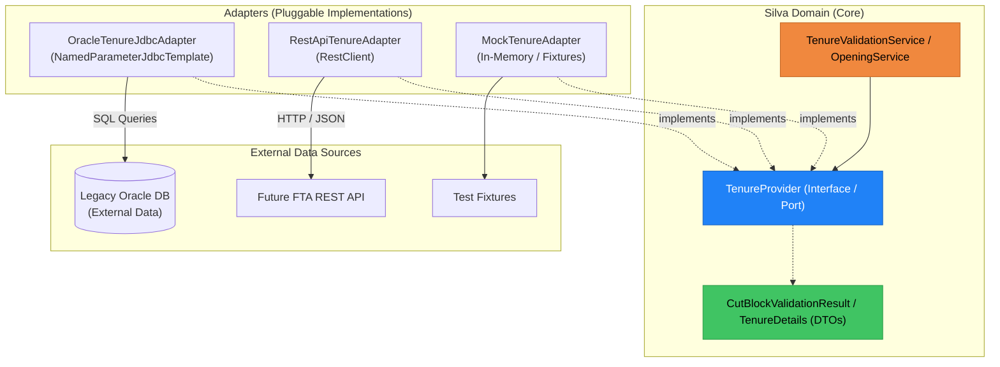

# Technical Specification: External Systems Anti-Corruption Layer (ACL)

## 1. Architecture Overview

Silva relies on external ministry systems (e.g., Forest Tenures Administration / FTA, Forest Client, Ministry Organization Units). In order to decouple Silva's domain from external database schemas and enable seamless migration to future REST APIs, all external dependencies follow a **Ports and Adapters (Hexagonal)** architecture with an **Anti-Corruption Layer (ACL)**.

> [!NOTE]
> **Tenures / FTA as the Primary Reference Implementation**
> This specification defines the universal integration architecture for **all external dependencies** in Silva (including Forest Client, Ministry Organization Units, SPAR/Seedlings, and future services).
>
> To ensure architectural guidance is grounded in concrete, compilable code rather than abstract pseudocode, **Forest Tenures Administration (FTA)** is used throughout this document as the primary reference implementation and pilot case study. The exact same package structure, port interfaces, delegating routers, and adapter tiers apply to all other external domains:
>
> | Domain | Port Interface (`common/provider`) | Concrete Adapters | Delegating Router (`@Primary`) |
> | :--- | :--- | :--- | :--- |
> | **Tenures (Reference)** | `TenureProvider` | `OracleTenureJdbcAdapter`, `RestApiTenureAdapter`, `MockTenureAdapter` | `DelegatingTenureProvider` |
> | **Forest Client** | `ForestClientProvider` | `OracleForestClientJdbcAdapter`, `RestApiForestClientAdapter`, `MockForestClientAdapter` | `DelegatingForestClientProvider` |
> | **Org Units** | `OrgUnitProvider` | `OracleOrgUnitJdbcAdapter`, `RestApiOrgUnitAdapter`, `MockOrgUnitAdapter` | `DelegatingOrgUnitProvider` |
> | **Future External Systems** | `XxxProvider` | `OracleXxxJdbcAdapter`, `RestApiXxxAdapter`, `MockXxxAdapter` | `DelegatingXxxProvider` |



### Key Principles

1. **Functional Intent Over Field Names:** Provider methods reflect Silva business questions (e.g. `validateCutBlockEligibility(...)`, `findTenureDetails(...)`), not database table queries (`select * from THE.CUT_BLOCK`).
2. **Strict Boundary Encapsulation:** External table names, column names (`CB_SKEY`, `SP_EXEMPT_IND`), and legacy quirks are completely contained inside the adapter.
3. **Per-Domain Independence:** Each external system (Tenures, OrgUnits, ForestClient) can be configured independently via Spring properties (`silva.integrations.<domain>.provider=oracle|api|mock`).
4. **Lightweight Connectivity:** In `primary-db=postgres` mode, Oracle queries run via a lightweight read-only `NamedParameterJdbcTemplate`, bypassing JPA EntityManager complexity.

---

## 2. Package Structure & Naming Conventions

All integration components follow standardized Silva package locations:

```
ca.bc.gov.restapi.results/
├── common/
│   ├── provider/                      # Provider interfaces (Ports) & REST adapters
│   │   ├── TenureProvider.java        # Port interface
│   │   ├── RestApiTenureAdapter.java  # Future REST API adapter
│   │   ├── handler/                   # Pluggable lifecycle hooks (e.g. TenureAssociationHandler)
│   │   └── mock/                      # Offline mock adapters for local dev/testing
│   │       └── MockTenureAdapter.java
│   ├── dto/                           # Silva domain records & DTOs
│   │   ├── ExternalCutBlockDetails.java
│   │   └── ExternalTenureSummary.java
│   └── configuration/                 # Integration & DataSource configuration
│       ├── ExternalIntegrationConfiguration.java
│       └── ExternalOracleConfiguration.java
├── oracle/
│   └── provider/                      # Concrete Oracle JDBC adapters
│       └── OracleTenureJdbcAdapter.java
└── postgres/
    └── service/                       # Silva domain services consuming the Provider
        └── TenureValidationService.java
```

---

## 3. Configuration & Bean Wiring

### 3.1 Application Properties (`application.yml`)

```yaml
silva:
  integrations:
    # Per-domain provider selection: 'oracle', 'api', or 'mock'
    tenure:
      provider: ${SILVA_INTEGRATION_TENURE_PROVIDER:oracle}
      api:
        base-url: ${FTA_API_BASE_URL:http://localhost:8081}
        timeout-ms: 5000
    org-unit:
      provider: ${SILVA_INTEGRATION_ORGUNIT_PROVIDER:oracle}
      cache-ttl-minutes: 60
    forest-client:
      provider: ${SILVA_INTEGRATION_FORESTCLIENT_PROVIDER:api}
    
    # Secondary Oracle read-only connection (active in Postgres mode when external-oracle is enabled)
    external-oracle:
      enabled: ${EXTERNAL_ORACLE_ENABLED:true}
      hikari:
        jdbc-url: ${spring.oracle.jdbcUrl}
        username: ${spring.oracle.username}
        password: ${spring.oracle.password}
        driver-class-name: oracle.jdbc.OracleDriver
        pool-name: SilvaExternalOracleConnPool
        maximum-pool-size: 3
        minimum-idle: 0
        connection-timeout: 15000
        idle-timeout: 60000
        connection-test-query: SELECT 1 FROM DUAL
```

### 3.2 Secondary Oracle DataSource Configuration (`ExternalOracleConfiguration.java`)

When running with `server.primary-db=postgres` and external Oracle integration is enabled (`silva.integrations.external-oracle.enabled=true`), this configuration activates a dedicated read-only DataSource and `NamedParameterJdbcTemplate`:

```java
package ca.bc.gov.restapi.results.common.configuration;

import com.zaxxer.hikari.HikariDataSource;
import javax.sql.DataSource;
import org.springframework.beans.factory.annotation.Qualifier;
import org.springframework.boot.autoconfigure.condition.ConditionalOnProperty;
import org.springframework.boot.context.properties.ConfigurationProperties;
import org.springframework.boot.jdbc.DataSourceBuilder;
import org.springframework.context.annotation.Bean;
import org.springframework.context.annotation.Configuration;
import org.springframework.jdbc.core.namedparam.NamedParameterJdbcTemplate;

@Configuration
@ConditionalOnProperty(prefix = "server", name = "primary-db", havingValue = "postgres")
public class ExternalOracleConfiguration {

  @Bean(name = "externalOracleDataSource")
  @ConditionalOnProperty(prefix = "silva.integrations.external-oracle", name = "enabled", havingValue = "true")
  @ConfigurationProperties(prefix = "silva.integrations.external-oracle.hikari")
  public DataSource externalOracleDataSource() {
    return DataSourceBuilder.create().type(HikariDataSource.class).build();
  }

  @Bean(name = "externalOracleJdbcTemplate")
  @ConditionalOnProperty(prefix = "silva.integrations.external-oracle", name = "enabled", havingValue = "true")
  public NamedParameterJdbcTemplate externalOracleJdbcTemplate(
      @Qualifier("externalOracleDataSource") DataSource dataSource) {
    NamedParameterJdbcTemplate template = new NamedParameterJdbcTemplate(dataSource);
    template.getJdbcTemplate().setQueryTimeout(5); // 5-second execution timeout for transactional validations
    return template;
  }
}
```

In `server.primary-db=oracle` mode, Silva already maintains its primary Oracle DataSource (`oracleDataSource`). To avoid spinning up a redundant second connection pool, `externalOracleJdbcTemplate` wraps the existing primary pool:

```java
@Configuration
@ConditionalOnProperty(prefix = "server", name = "primary-db", havingValue = "oracle")
public class PrimaryOracleTemplateConfiguration {

  @Bean(name = "externalOracleJdbcTemplate")
  public NamedParameterJdbcTemplate externalOracleJdbcTemplate(
      @Qualifier("oracleDataSource") DataSource dataSource) {
    NamedParameterJdbcTemplate template = new NamedParameterJdbcTemplate(dataSource);
    template.getJdbcTemplate().setQueryTimeout(5); // 5-second execution timeout for transactional validations
    return template;
  }
}
```

---

## 4. Port & Domain Contract Definition

The following sections illustrate the contract and adapter patterns using **Tenure / Cut Block** as the concrete reference pilot. Every other external dependency implements analogous DTOs, Provider interfaces, and adapter classes.

### 4.1 Domain Value Objects (`common/dto`)

```java
package ca.bc.gov.restapi.results.common.dto;

/**
 * Domain record encapsulating cut block details verified against the external authority (e.g. FTA).
 * Note: Opening associations and availability are owned by Silva's persistence store
 * (silva.cut_block_open_admin) and are evaluated by Silva domain services, not the external provider.
 */
public record ExternalCutBlockDetails(
    boolean exists,
    Long cbSkey,
    boolean clientIsLicensee,
    String timberMark,
    String status
) {
  public static ExternalCutBlockDetails notFound() {
    return new ExternalCutBlockDetails(false, null, false, null, null);
  }
}
```

```java
package ca.bc.gov.restapi.results.common.dto;

public record ExternalTenureSummary(
    String forestFileId,
    String cuttingPermitId,
    String cutBlockId,
    String timberMark,
    String licenseeClientNumber,
    String status
) {}
```

### 4.2 The Provider Port (`common/provider/TenureProvider.java`)

```java
package ca.bc.gov.restapi.results.common.provider;

import ca.bc.gov.restapi.results.common.dto.ExternalCutBlockDetails;
import ca.bc.gov.restapi.results.common.dto.ExternalTenureSummary;
import java.util.Optional;

/**
 * Functional port for retrieving and validating external tenure and cut block data.
 * Implementations translate external sources (Oracle DB, REST API, or Mocks) into
 * clean Silva domain records.
 */
public interface TenureProvider {

  /**
   * Validates cut block existence and licensee authorization against the external authority.
   *
   * @param forestFileId tenure file ID (e.g. TFL001)
   * @param cuttingPermitId cutting permit (may be null)
   * @param cutBlockId cut block ID
   * @param clientNumber client number claiming licensee rights
   * @return external cut block verification details
   */
  ExternalCutBlockDetails verifyCutBlock(
      String forestFileId,
      String cuttingPermitId,
      String cutBlockId,
      String clientNumber);

  /**
   * Retrieves summary tenure details for a cut block.
   */
  Optional<ExternalTenureSummary> getTenureSummary(
      String forestFileId, String cuttingPermitId, String cutBlockId);
}
```

---

## 5. Adapter Implementations

### 5.1 Oracle JDBC Adapter (`oracle/provider/OracleTenureJdbcAdapter.java`)

```java
package ca.bc.gov.restapi.results.oracle.provider;

import ca.bc.gov.restapi.results.common.dto.ExternalCutBlockDetails;
import ca.bc.gov.restapi.results.common.dto.ExternalTenureSummary;
import ca.bc.gov.restapi.results.common.provider.TenureProvider;
import java.util.Optional;
import lombok.RequiredArgsConstructor;
import lombok.extern.slf4j.Slf4j;
import org.springframework.boot.autoconfigure.condition.ConditionalOnProperty;
import org.springframework.dao.EmptyResultDataAccessException;
import org.springframework.jdbc.core.namedparam.MapSqlParameterSource;
import org.springframework.jdbc.core.namedparam.NamedParameterJdbcTemplate;
import org.springframework.stereotype.Component;

@Slf4j
@Component("oracleTenureJdbcAdapter")
@RequiredArgsConstructor
public class OracleTenureJdbcAdapter implements TenureProvider {

  private final NamedParameterJdbcTemplate externalOracleJdbcTemplate;

  private static final String SQL_VALIDATE_CUT_BLOCK = """
      SELECT
        cb.CB_SKEY,
        cb.TIMBER_MARK,
        cb.BLOCK_STATUS_ST,
        CASE WHEN EXISTS (
          SELECT 1 FROM THE.CUT_BLOCK_CLIENT cbc
          WHERE cbc.CB_SKEY = cb.CB_SKEY
            AND cbc.CLIENT_NUMBER = :clientNumber
        ) THEN 1 ELSE 0 END AS IS_LICENSEE
      FROM THE.CUT_BLOCK cb
      WHERE cb.FOREST_FILE_ID = :forestFileId
        AND cb.CUT_BLOCK_ID = :cutBlockId
        AND (:cuttingPermitId IS NULL AND cb.CUTTING_PERMIT_ID IS NULL
             OR cb.CUTTING_PERMIT_ID = :cuttingPermitId)
      """;

  @Override
  public ExternalCutBlockDetails verifyCutBlock(
      String forestFileId,
      String cuttingPermitId,
      String cutBlockId,
      String clientNumber) {

    MapSqlParameterSource params = new MapSqlParameterSource()
        .addValue("forestFileId", forestFileId)
        .addValue("cuttingPermitId", cuttingPermitId)
        .addValue("cutBlockId", cutBlockId)
        .addValue("clientNumber", clientNumber);

    try {
      return externalOracleJdbcTemplate.queryForObject(
          SQL_VALIDATE_CUT_BLOCK,
          params,
          (rs, rowNum) -> {
            boolean exists = true;
            long rawCbSkey = rs.getLong("CB_SKEY");
            Long cbSkey = rs.wasNull() ? null : rawCbSkey;
            boolean isLicensee = rs.getInt("IS_LICENSEE") == 1;
            String timberMark = rs.getString("TIMBER_MARK");
            String status = rs.getString("BLOCK_STATUS_ST");

            return new ExternalCutBlockDetails(
                exists, cbSkey, isLicensee, timberMark, status);
          });
    } catch (EmptyResultDataAccessException e) {
      return ExternalCutBlockDetails.notFound();
    }
  }

  @Override
  public Optional<ExternalTenureSummary> getTenureSummary(
      String forestFileId, String cuttingPermitId, String cutBlockId) {
    // SQL query returning ExternalTenureSummary
    return Optional.empty();
  }
}
```

### 5.2 Future REST API Adapter (`common/provider/RestApiTenureAdapter.java`)

```java
package ca.bc.gov.restapi.results.common.provider;

import ca.bc.gov.restapi.results.common.dto.ExternalCutBlockDetails;
import ca.bc.gov.restapi.results.common.dto.ExternalTenureSummary;
import java.util.Optional;
import lombok.RequiredArgsConstructor;
import lombok.extern.slf4j.Slf4j;
import org.springframework.boot.autoconfigure.condition.ConditionalOnProperty;
import org.springframework.stereotype.Component;
import org.springframework.web.client.RestClient;

@Slf4j
@Component("restApiTenureAdapter")
@RequiredArgsConstructor
public class RestApiTenureAdapter implements TenureProvider {

  private final RestClient ftaRestClient;

  @Override
  public ExternalCutBlockDetails verifyCutBlock(
      String forestFileId,
      String cuttingPermitId,
      String cutBlockId,
      String clientNumber) {
    
    // Future REST call to FTA API: GET /api/cut-blocks/verify?...
    return ftaRestClient.get()
        .uri(uriBuilder -> uriBuilder
            .path("/api/cut-blocks/verify")
            .queryParam("forestFileId", forestFileId)
            .queryParam("cuttingPermitId", cuttingPermitId)
            .queryParam("cutBlockId", cutBlockId)
            .queryParam("clientNumber", clientNumber)
            .build())
        .retrieve()
        .body(ExternalCutBlockDetails.class);
  }

  @Override
  public Optional<ExternalTenureSummary> getTenureSummary(
      String forestFileId, String cuttingPermitId, String cutBlockId) {
    return Optional.empty();
  }
}
```

### 5.3 Mock Adapter for Offline Dev / Testing (`common/provider/mock/MockTenureAdapter.java`)

```java
package ca.bc.gov.restapi.results.common.provider.mock;

import ca.bc.gov.restapi.results.common.dto.ExternalCutBlockDetails;
import ca.bc.gov.restapi.results.common.dto.ExternalTenureSummary;
import ca.bc.gov.restapi.results.common.provider.TenureProvider;
import java.util.Map;
import java.util.Optional;
import java.util.concurrent.ConcurrentHashMap;
import org.springframework.stereotype.Component;

@Component("mockTenureAdapter")
public class MockTenureAdapter implements TenureProvider {

  private final Map<String, ExternalCutBlockDetails> fixtures = new ConcurrentHashMap<>();

  public void registerFixture(String key, ExternalCutBlockDetails details) {
    fixtures.put(key, details);
  }

  @Override
  public ExternalCutBlockDetails verifyCutBlock(
      String forestFileId,
      String cuttingPermitId,
      String cutBlockId,
      String clientNumber) {

    String key = forestFileId + ":" + (cuttingPermitId != null ? cuttingPermitId : "") + ":" + cutBlockId;
    return fixtures.getOrDefault(key,
        new ExternalCutBlockDetails(true, 1001L, true, "47/12K", "ACT"));
  }

  @Override
  public Optional<ExternalTenureSummary> getTenureSummary(
      String forestFileId, String cuttingPermitId, String cutBlockId) {
    return Optional.of(new ExternalTenureSummary(
        forestFileId, cuttingPermitId, cutBlockId, "47/12K", "00010003", "ACT"));
  }
}
```

### 5.4 Runtime Delegating Provider (`common/provider/DelegatingTenureProvider.java`)

In Spring Boot 3 + GraalVM Native Image mode, `@ConditionalOnProperty` is evaluated at Ahead-of-Time (AOT) build time. Any bean conditioned out during the build is pruned from the compiled binary and cannot be re-enabled at runtime.

To allow switching providers in OpenShift solely via environment variables (`SILVA_INTEGRATION_TENURE_PROVIDER=oracle|api|mock`) without rebuilding container images, all adapters are registered as Spring beans and wrapped by a `@Primary` delegating router:

```java
package ca.bc.gov.restapi.results.common.provider;

import ca.bc.gov.restapi.results.common.dto.ExternalCutBlockDetails;
import ca.bc.gov.restapi.results.common.dto.ExternalTenureSummary;
import java.util.Map;
import java.util.Optional;
import org.springframework.context.annotation.Primary;
import org.springframework.core.env.Environment;
import org.springframework.stereotype.Component;

@Component
@Primary
public class DelegatingTenureProvider implements TenureProvider {

  private final Map<String, TenureProvider> adapters;
  private final Environment environment;

  public DelegatingTenureProvider(Map<String, TenureProvider> adapters, Environment environment) {
    this.adapters = adapters;
    this.environment = environment;
  }

  private TenureProvider getDelegate() {
    String provider = environment.getProperty("silva.integrations.tenure.provider", "oracle");
    String beanName = switch (provider.toLowerCase()) {
      case "api" -> "restApiTenureAdapter";
      case "mock" -> "mockTenureAdapter";
      default -> "oracleTenureJdbcAdapter";
    };

    TenureProvider delegate = adapters.get(beanName);
    if (delegate == null) {
      throw new IllegalStateException("No TenureProvider bean found for: " + provider);
    }
    return delegate;
  }

  @Override
  public ExternalCutBlockDetails verifyCutBlock(
      String forestFileId, String cuttingPermitId, String cutBlockId, String clientNumber) {
    return getDelegate().verifyCutBlock(forestFileId, cuttingPermitId, cutBlockId, clientNumber);
  }

  @Override
  public Optional<ExternalTenureSummary> getTenureSummary(
      String forestFileId, String cuttingPermitId, String cutBlockId) {
    return getDelegate().getTenureSummary(forestFileId, cuttingPermitId, cutBlockId);
  }
}
```

---

## 6. Flexible Data Ownership & Association Hooks

### 6.1 Clean Ownership Boundary: External vs. Internal

1. **External Authority:** Owns CutBlock existence, Timber Mark, status, and Licensee status.
2. **Silva Persistence (`silva.cut_block_open_admin`):** Exclusively owns Opening-to-Tenure associations and opening availability.

```java
// How Silva's TenureValidationService orchestrates validation:
public TenureValidationResultDto validateTenure(
    TenureRequestDto request, String clientNumber, Long excludedOpeningId) {

  // 1. External verification against external provider port
  ExternalCutBlockDetails ext = tenureProvider.verifyCutBlock(
      request.fileId(), request.cuttingPermit(), request.cutBlock(), clientNumber);

  if (!ext.exists()) {
    return TenureValidationResultDto.fail(TenureValidationErrorCode.TENURE_NOT_FOUND);
  }
  if (!ext.clientIsLicensee()) {
    return TenureValidationResultDto.fail(TenureValidationErrorCode.CLIENT_NOT_LICENSEE);
  }

  // 2. Silva-owned opening association check in PostgreSQL (allowing excludedOpeningId for edits)
  boolean allocated = excludedOpeningId == null
      ? cutBlockOpenAdminRepository.existsAllocatedByTenure(
          request.fileId(), request.cutBlock(), request.cuttingPermit())
      : cutBlockOpenAdminRepository.existsAllocatedByTenureForAnotherOpening(
          request.fileId(), request.cutBlock(), request.cuttingPermit(), excludedOpeningId);

  if (allocated) {
    return TenureValidationResultDto.fail(TenureValidationErrorCode.TENURE_DUPLICATE_OPENING);
  }

  return TenureValidationResultDto.success(ext.timberMark());
}
```

### 6.2 System-Wide CQRS & Read Model Projections

Silva separates operational commands from read-heavy cross-domain queries across all external dependencies (FTA/Tenures, Forest Client, BCGW/Org Units, and future integrated services):

- **The Cross-Network Join & $N+1$ Trap:**
  - Joining external REST APIs or issuing remote HTTP calls across hundreds or thousands of records introduces crippling network latency and rate-limit exhaustion.
  - Furthermore, spatial GIS queries (e.g. PostGIS `ST_Intersects` between opening boundaries and external tenures or administrative zones) **cannot be executed over REST APIs**.
- **When to Use Local Read Projections:**
  1. **Multi-Criteria Searches & Filtering:** Filtering openings by tenure, client, or geographic coordinates without calling external APIs per record.
  2. **Composite Dashboards & Detail Views:** Rendering rich opening summaries and headers in a single query without cascading REST calls.
  3. **Spatial Overlays:** Combining opening geometries with external administrative or tenure boundaries in PostGIS.
  4. **Reporting & Bulk Data Exports:** Producing annual reports and bulk shapefile/CSV downloads without hitting external rate limits.
- **Architectural Division of Labor:**
  - **Command Path (Writes & Authoritative Validations):** State-changing actions and validation checks query the live domain port (`*Provider`, e.g. `TenureProvider.verifyCutBlock`, `ForestClientProvider.getClient`) to enforce business rules against the authoritative system of record.
  - **Query Path (High-Performance Local Reads):** All multi-entity searches, dashboards, spatial analysis, and reports execute 100% locally against indexed PostgreSQL tables and read model projections.

### 6.3 Case Study: External Ownership of Cut Block Opening Administration (FTA-Owned CBOA)

As an illustrative application of this pattern, consider the scenario where FTA is the master system of record for cut block opening associations (`cut_block_open_admin`):
1. **System of Record:** FTA owns the authoritative cut block to opening relationship.
2. **Silva Read Projection:** Silva maintains `silva.cut_block_open_admin` as a local, indexed read model projection in PostgreSQL to power fast opening searches and spatial mapping.
3. **Data Synchronization Patterns:**
   - **Write-Through Hook:** When a user links or unlinks a tenure in Silva, `TenureAssociationHandler` emits an asynchronous event or REST notification to FTA.
   - **Event Streaming / CDC:** When associations change in FTA, events (via Kafka/EventBridge) or CDC (Debezium) update Silva's local read projection.
   - **Periodic Reconciliation:** A background sync job polls `GET /api/tenures/associations/changes?since=...` to guarantee eventual consistency across read models.

### 6.4 Association Lifecycle Hooks

To ensure future flexibility when tenure associations are modified in Silva:

```java
package ca.bc.gov.restapi.results.common.provider.handler;

/**
 * Optional lifecycle hook invoked when Silva associates or dissociates a tenure
 * with an opening. Default implementation is a no-op; can be extended for bi-directional
 * event emission or legacy synchronization.
 */
public interface TenureAssociationHandler {
  default void onTenureAssociated(Long openingId, String forestFileId, String cuttingPermitId, String cutBlockId) {}
  default void onTenureRemoved(Long openingId, Long cboaId) {}
}
```

---

## 7. Caching & Resilience Policy

| Data Category | Examples | Caching Strategy | Timeout Policy | Failure Behavior |
|---|---|---|---|---|
| **Transactional Checks** | Cut block existence, licensee authorization, opening availability | **No cache** (always live query) | 5s query / HTTP timeout | **Fail fast** (throw `ExternalServiceUnavailableException` -> HTTP 503) |
| **Reference Data** | Organization units, code tables, district rollups | **In-memory cache** (Caffeine TTL = 60 min) | 10s query timeout | **Serve stale** cache on failure; degrade with warning |
| **Enrichment Data** | Forest client autocomplete, tenure summaries for display | **Short-term cache** (TTL = 10 min) | 3s timeout | Return partial DTO with `externalDataUnavailable: true` |

---

## 8. Verification & Testing Strategy

1. **Unit Tests:** Mock `TenureProvider` using standard Mockito in domain service tests (`TenureValidationServiceTest`).
2. **Adapter Contract Tests:**
   - Test `OracleTenureJdbcAdapter` against TestContainers Oracle XE / mock queries.
   - Test `RestApiTenureAdapter` using `WireMock` / `MockRestServiceServer`.
   - Test `MockTenureAdapter` in offline local builds (`-Dsilva.integrations.tenure.provider=mock`).
3. **Dual-DB Smoke Tests:** Ensure both `-Dserver.primary-db=oracle` and `-Dserver.primary-db=postgres` compile and start up cleanly with the secondary JDBC template.
