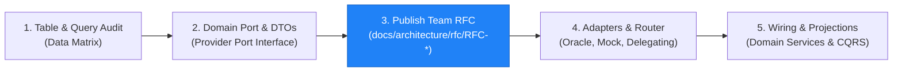
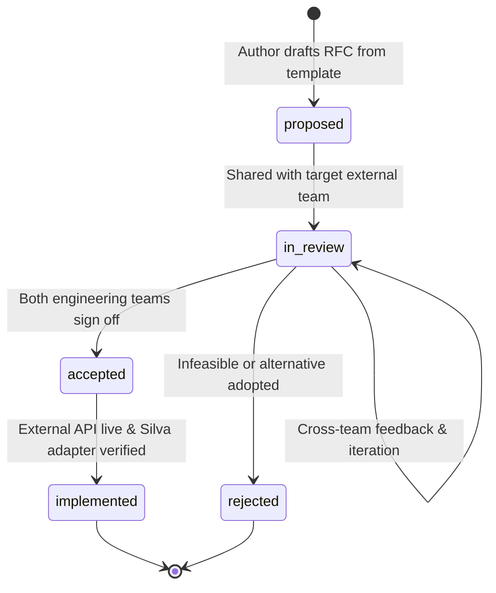

# Cross-Team Interface RFC Registry

## 1. Overview

As Silva modernizes from RESULTS and decouples from monolithic Oracle databases, external ministry systems (e.g., Forest Tenures Administration / FTA, Forest Client, Ministry Organization Units, SPAR) will modernize on independent schedules.

To ensure Silva drives interface requirements based on **actual domain consumer needs** (rather than accepting arbitrary API designs or remaining coupled to legacy database columns), all external integration contracts follow a formal **Request for Comments (RFC)** framework.

This RFC process operates within Silva's **Anti-Corruption Layer (ACL)** and **Hexagonal Architecture** ([ADR-001](../adr/ADR-001-external-systems-anti-corruption-layer.md)):

Silva uses an interim Oracle JDBC adapter to deliver immediate functionality without blocking on external team schedules. Concurrently, Silva publishes an RFC defining the modern interface contract (synchronous REST API or asynchronous domain events) for the external engineering team. When the external system's API is ready, Silva implements a `RestApi<Domain>Adapter` and switches via an OpenShift runtime environment variable (`SILVA_INTEGRATION_<DOMAIN>_PROVIDER=api`), requiring zero code changes in domain services.

---

## 2. RFC Index & Registry

RFC identifiers (`RFC-XXX`) are assigned sequentially as contracts are scheduled and drafted. 

The initial pilot contract is **RFC-001 (FTA)**. Subsequent domains identified in the [Data Integration Matrix](../data-integration-matrix.md#3-external-dependency-tables-anti-corruption-layer-scope) (e.g., Forest Client, Org Units, SPAR, FSP, BEC) will be prioritized and assigned RFC IDs following the **Convergence Gate: Pilot Retrospective & Domain Prioritization** ([#1528](https://github.com/bcgov/nr-silva/issues/1528)).

| RFC ID | Target System | Title | Type | Status | Related Port | Tracking |
| :---: | :---: | :--- | :---: | :---: | :---: | :---: |
| **[RFC-001](https://github.com/bcgov/nr-silva/issues/1527)** *(Planned)* | **FTA** | Forest Tenures Administration Integration Contract | `hybrid` | `proposed` | `TenureProvider` | Pilot ([#1527](https://github.com/bcgov/nr-silva/issues/1527)) |
| *To be assigned* | *Candidate Domains* | *Forest Client, Org Units, SPAR, FSP, BEC, etc.* | *TBD* | *Pending Gate* | *See Data Matrix* | [#1528](https://github.com/bcgov/nr-silva/issues/1528) |

---

## 3. RFC Lifecycle States

Every RFC progresses through standardized lifecycle states:

1. **`proposed`**: The RFC is drafted by the Silva engineering team using [`template.md`](./template.md). It details Silva's consumer needs, proposed REST endpoints and/or event schemas, DTO field mappings, performance SLAs, and security protocols.
2. **`in_review`**: The RFC is formally submitted to the target system's engineering team and product owner. Cross-team reviews, technical negotiations, and schema adjustments take place.
3. **`accepted`**: Both Silva and external teams agree on the contract, payload schemas, error formats, and implementation milestones.
4. **`implemented`**: The external team deploys the API/event stream in production/staging and Silva completes the integration according to `interface_type`:
   - **`synchronous_rest`:** Silva implements `RestApi*Adapter` (using Spring `RestClient`), verifies via WireMock contract tests, and activates via OpenShift runtime configuration (`SILVA_INTEGRATION_<DOMAIN>_PROVIDER=api`).
   - **`asynchronous_event`:** Silva implements event consumers/handlers to ingest events into local PostgreSQL read projections (`silva.*`), with contract tests verifying CloudEvents payload deserialization and idempotency.
   - **`hybrid`:** Delivers both the synchronous REST adapter and asynchronous projection consumers.
5. **`rejected`**: The proposal is declined or superseded by an alternative architecture.

---

## 4. How to Create a New RFC

1. Copy [`docs/architecture/rfc/template.md`](./template.md) to `docs/architecture/rfc/RFC-<number>-<short-descriptive-slug>.md`.
2. Assign the next sequential RFC number (e.g., `RFC-002-forest-client-verification.md`).
3. Fill in the MADR-style YAML frontmatter:
   - `id`: `RFC-XXX`
   - `title`: Descriptive title
   - `target_system`: Target external system (e.g. `FTA`, `Forest Client`, `Org Units`)
   - `interface_type`: `synchronous_rest` | `asynchronous_event` | `hybrid`
   - `status`: `proposed`
   - `date`: Current date (`YYYY-MM-DD`)
   - `related_provider`: Silva Provider interface name (e.g. `TenureProvider`)
4. Complete all required sections covering business context, sync/async contracts, domain DTO mappings, SLAs, and security.
5. Register the new RFC in the table in [Section 2](#2-rfc-index--registry) of this README.
6. Open a GitHub pull request to Silva with the RFC document for architectural review.
7. Once merged into Silva, share the markdown document with the external system team to begin the `in_review` phase.

---

## 5. Related Documentation

- **[ADR-001: Anti-Corruption Layer for External System Dependencies](../adr/ADR-001-external-systems-anti-corruption-layer.md)**
- **[External Systems Integration Specification](../external-systems-integration-spec.md)**
- **[Data Integration Matrix](../data-integration-matrix.md)**
- **[Backend Integration Patterns Reference Guide](../../.agents/skills/backend-patterns/references/integration-patterns.md)**
- **[Epic #1517: Decouple Silva from Monolithic Oracle Database](https://github.com/bcgov/nr-silva/issues/1517)**

