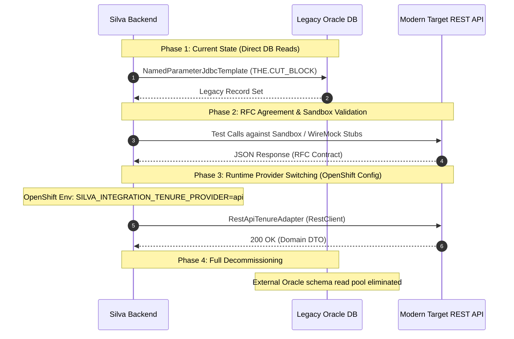

# RFC-XXX: [Short Descriptive Title of the Cross-Team Interface]

> [!NOTE]
> **RFC Purpose:** This Request for Comments (RFC) defines the consumer-driven interface contract between the **Silva (RESULTS Modernization)** platform and **[Target System Name]**. 
> As Silva decouples from monolithic Oracle schemas via its **Anti-Corruption Layer (ACL)**, this RFC establishes the target interface (REST API and/or domain event stream) required to replace direct database queries.

> [!IMPORTANT]
> ### Public Repository Compliance & Sanitization
> All RFC documents published in this repository must remain compliant with:
> - **Zero PII or Production Identity:** Do not commit personal licensee data, phone numbers, or real user IDIRs. Use generic placeholders (e.g., `IDIR\EXAMPLE_USER`, `EXAMPLE FORESTRY CORP`).
> - **Zero Credentials / Secrets:** Never include tokens, passwords, client secrets, or private network endpoints.
> - **Domain Focus over Physical DDL:** Focus on domain-level DTOs and API contracts. Physical Oracle DDL, internal indexes, and cross-system foreign key constraints remain documented in internal architecture wikis.

---

## 1. Business Context & Consumer Need

### 1.1 Background & Silva Architecture Context
Briefly describe the business and technical context within Silva that motivates this integration. Mention how this fits into Silva's Ports & Adapters (Hexagonal) architecture and Anti-Corruption Layer (referencing [ADR-001](../adr/ADR-001-external-systems-anti-corruption-layer.md) and [External Systems Integration Spec](../external-systems-integration-spec.md)).

### 1.2 Consumer Need & Business Workflows
Explain precisely **why** Silva requires this data or capability. Highlight the specific user journeys and business rules, such as:
- **Authoritative Validation:** e.g., Verifying that a Cut Block exists, is in an active status, and is legally held by the client when creating or editing an opening (`AddTenure` / `EditTenure` workflow).
- **Licensee Verification:** e.g., Confirming that the authenticated user's organization has harvesting or silviculture rights for the given forest file identifier.
- **Data Enrichment:** e.g., Populating display summaries (timber mark, tenure status, operational dates) on opening search and detail screens.

### 1.3 System Authority & Boundary Ownership
Clarify the authoritative source of record versus the consumer:
- **System of Record (Target System):** Authoritative owner of the business entity (e.g., FTA owns Cut Blocks, Tenures, and Timber Marks).
- **Consumer (Silva):** Consumer of external entities; authoritative owner of internal associations (e.g., Silva owns the link between an Opening and a Cut Block via `silva.cut_block_open_admin`).

---

## 2. Current State & Interim Anti-Corruption Layer

### 2.1 Current Direct Database Access
Describe how Silva currently accesses the target system's data in the shared Oracle environment:
- **Legacy Schema & Tables:** e.g., `THE.CUT_BLOCK`, `THE.CUT_BLOCK_CLIENT`, `THE.FOREST_FILE_CLIENT`.
- **Query Patterns:** e.g., SQL queries joining external tables by `CB_SKEY` or `FOREST_FILE_ID`.
- **Coupling Risks:** Direct coupling to external column names, missing database constraints across schemas, and inability to run pure PostgreSQL deployments.

### 2.2 Interim Silva Adapter Implementation
Describe Silva's interim read-only adapter implementing the domain port:
- **Port Interface:** `ca.bc.gov.restapi.results.common.provider.[Target]Provider`
- **Interim Adapter:** `ca.bc.gov.restapi.results.oracle.provider.Oracle[Target]JdbcAdapter` executing via the secondary read-only Oracle connection pool with strict execution timeouts (5 seconds).
- **Mock Adapter:** `ca.bc.gov.restapi.results.common.provider.mock.Mock[Target]Adapter` for offline development.

---

## 3. Proposed Interface Contracts

Depending on the `interface_type` (`synchronous_rest`, `asynchronous_event`, or `hybrid`), complete the corresponding subsections below.

```
+-----------------------------------------------------------------------------------------+
|                               INTERFACE TYPE GUIDELINES                                 |
|                                                                                         |
| - synchronous_rest:  Required for synchronous user-driven validations (e.g. form save, |
|                      authoritative pre-condition checks, real-time lookups).            |
| - asynchronous_event: Required for data synchronization, read model projections, status  |
|                      change notifications, and cache invalidation.                       |
| - hybrid:            Synchronous REST for transactional checks + Domain Events for CQRS |
|                      projections and cache invalidation.                                |
+-----------------------------------------------------------------------------------------+
```

### 3.1 Synchronous Contract (REST / HTTP)

#### 3.1.1 Endpoints Overview

| Method | Resource Path | Purpose | Idempotent | SLA (p95) |
| :--- | :--- | :--- | :---: | :---: |
| `GET` | `/api/v1/cut-blocks/verify` | Verify cut block eligibility and licensee | Yes | < 250 ms |
| `POST` | `/api/v1/cut-blocks/batch-verify` | Batch verification for multi-tenure openings | Yes | < 500 ms |
| `GET` | `/api/v1/tenures/{fileId}/summary` | Retrieve tenure detail summary | Yes | < 200 ms |

#### 3.1.2 Request Specification

**Headers:**
- `Authorization: Bearer <jwt-token>`
- `X-Correlation-ID: <uuid>` (distributed tracing)
- `Accept: application/json`
- `Content-Type: application/json` (for POST/PUT)

**Query / Path Parameters:**
```
GET /api/v1/cut-blocks/verify?forestFileId={fileId}&cuttingPermitId={permitId}&cutBlockId={blockId}&clientNumber={clientNo}
```

| Parameter | Type | Required | Description | Example |
| :--- | :--- | :---: | :--- | :--- |
| `forestFileId` | String | Yes | Forest tenure file identifier | `"TFL47"` |
| `cuttingPermitId` | String | No | Cutting permit identifier (blank for non-permit tenures) | `"12K"` |
| `cutBlockId` | String | Yes | Cut block identifier | `"BLK-01"` |
| `clientNumber` | String | No | Client number for licensee eligibility check | `"00012345"` |

**Sample Request Body (for Batch or Complex Endpoints):**
```json
{
  "clientNumber": "00012345",
  "items": [
    {
      "forestFileId": "TFL47",
      "cuttingPermitId": "12K",
      "cutBlockId": "BLK-01"
    }
  ]
}
```

#### 3.1.3 Response Specification

**Success Response (HTTP 200 OK):**
```json
{
  "exists": true,
  "externalKey": 1001524,
  "clientIsLicensee": true,
  "timberMark": "47/12K",
  "status": "ACT",
  "statusCodeDescription": "Active",
  "forestFileId": "TFL47",
  "cuttingPermitId": "12K",
  "cutBlockId": "BLK-01",
  "licensee": {
    "clientNumber": "00012345",
    "clientName": "EXAMPLE FOREST PRODUCTS CORP"
  }
}
```

**Not Found Response (HTTP 404 Not Found):**
```json
{
  "type": "https://example.gov.bc.ca/errors/resource-not-found",
  "title": "Cut Block Not Found",
  "status": 404,
  "detail": "Cut block BLK-01 under permit 12K, file TFL47 was not found.",
  "instance": "/api/v1/cut-blocks/verify",
  "timestamp": "2026-10-28T14:30:00Z"
}
```

**Error Handling & Problem Details (RFC 7807):**
All 4xx and 5xx responses must return RFC 7807 `application/problem+json` payloads:

| HTTP Status | Reason / Scenario | Silva Client Action |
| :---: | :--- | :--- |
| `400 Bad Request` | Malformed parameters or invalid identifier format | Reject request with validation error |
| `401 / 403` | Invalid or expired token, missing scopes | Log security error, refresh service token |
| `404 Not Found` | Entity does not exist in target system | Return domain `notFound()` result to caller |
| `422 Unprocessable` | Semantic validation failed (e.g. retired tenure) | Display specific business rule error |
| `429 Too Many Req` | Rate limit exceeded | Backoff and retry (respect `Retry-After`) |
| `500 / 502 / 503` | Target service failure or upstream timeout | Circuit breaker trips; fallback to 503 |

---

### 3.2 Asynchronous Contract (Domain Events / Messaging)

#### 3.2.1 Event Catalog

| Event Name | Triggering Business Action in Target System | Silva Action / Use Case |
| :--- | :--- | :--- |
| `tenure.cutblock.created` | New cut block authorized in FTA | Invalidate cache; optionally ingest into projection |
| `tenure.cutblock.updated` | Cut block status change, geometry edit, or timber mark change | Update local PostgreSQL read projection (`silva.cut_block_open_admin`) |
| `tenure.cutblock.retired` | Cut block cancelled, deleted, or retired | Flag active opening tenures for operational review |
| `tenure.licensee.transferred`| Forest file ownership transferred to another licensee | Re-verify opening administration licensee compliance |

#### 3.2.2 Event Message Schema (CloudEvents 1.0 Specification)

Events should comply with the **CNCF CloudEvents 1.0** specification over Apache Kafka, RabbitMQ, or HTTP Webhooks.

```json
{
  "specversion": "1.0",
  "id": "e4f8b910-1a2b-4c3d-8e5f-6a7b8c9d0e1f",
  "source": "/fta/cut-blocks",
  "type": "ca.bc.gov.forestry.fta.cutblock.updated",
  "subject": "TFL47/12K/BLK-01",
  "time": "2026-10-28T14:30:00.000Z",
  "datacontenttype": "application/json",
  "data": {
    "externalKey": 1001524,
    "forestFileId": "TFL47",
    "cuttingPermitId": "12K",
    "cutBlockId": "BLK-01",
    "status": "ACT",
    "timberMark": "47/12K",
    "licenseeClientNumber": "00012345",
    "updatedAt": "2026-10-28T14:29:55Z",
    "updatedBy": "IDIR\\EXAMPLE_USER"
  }
}
```

#### 3.2.3 Message Delivery Guarantees & Constraints
- **Delivery Semantic:** At-least-once delivery. Silva consumers are implemented to be idempotent using the event `id` and entity version/timestamp.
- **Partitioning & Ordering:** Events keyed by the primary domain identifier (e.g. `forestFileId` or `externalKey`) to guarantee in-order delivery per entity.
- **Dead-Letter Queue (DLQ):** Unprocessable events routed to `<topic>-silva-dlq` after 3 retries with exponential backoff.
- **Projection Bootstrapping & Catch-Up Strategy:**
  - *Baseline Initialization:* Bounded change-event streams cannot initialize a complete read projection because entities unmodified during the retention window are omitted. The target system must provide a full snapshot baseline (e.g., bulk export endpoint, paginated sync API, or compacted Kafka topic) with an agreed checkpoint timestamp or offset.
  - *Incremental Catch-Up:* Silva seeds the local projection from the baseline snapshot, then consumes retained change events forward from the snapshot checkpoint.
  - *Event Retention Window:* Target system maintains event retention (minimum 7–14 days) to allow consumer catch-up following extended maintenance or disaster recovery.

---

## 4. Data Schemas & Silva Consumer DTO Mapping

### 4.1 Target Silva Domain DTO (Port Boundary)
Silva converts external responses into immutable Java records within `ca.bc.gov.restapi.results.common.dto`:

```java
package ca.bc.gov.restapi.results.common.dto;

import java.io.Serializable;

/**
 * Clean domain record representing cut block details consumed from external systems.
 * Free of legacy database column names (e.g. CB_SKEY, SP_EXEMPT_IND).
 */
public record ExternalCutBlockDetails(
    boolean exists,
    Long externalKey,
    boolean clientIsLicensee,
    String timberMark,
    String status,
    String statusCodeDescription,
    String forestFileId,
    String cuttingPermitId,
    String cutBlockId
) implements Serializable {

  public static ExternalCutBlockDetails notFound() {
    return new ExternalCutBlockDetails(
        false, null, false, null, null, null, null, null, null);
  }
}
```

### 4.2 Cross-System Field Mapping Table

| Target System Field | Silva Domain Record Field | Data Type | Nullable | Semantics & Transformation |
| :--- | :--- | :--- | :---: | :--- |
| `cb_skey` / `externalKey` | `externalKey` | `Long` | No | Unique surrogate key in source system |
| `forest_file_id` | `forestFileId` | `String` | No | Trimmed uppercase string (max 10 chars) |
| `cutting_permit_id` | `cuttingPermitId` | `String` | Yes | Blank/null mapped to empty string |
| `cut_block_id` | `cutBlockId` | `String` | No | Cut block identifier within permit |
| `block_status_code` | `status` | `String` | No | e.g. `"ACT"`, `"RET"`, `"LOG"` |
| `client_is_licensee` | `clientIsLicensee` | `boolean` | No | Evaluated by source system or derived from client list |
| `timber_mark` | `timberMark` | `String` | Yes | Formatted timber mark string |

---

## 5. Performance, Operational SLAs & Resilience

### 5.1 Latency Budgets & Throughput

```
+-----------------------------------------------------------------------------------------+
|                                    LATENCY BUDGETS                                      |
|                                                                                         |
|  Single Entity Check (p95):       <= 250 ms                                             |
|  Single Entity Check (p99):       <= 500 ms                                             |
|  Batch Verification (p95):        <= 500 ms (up to 50 items)                            |
|  Expected Normal Throughput:      10 - 25 req/sec                                       |
|  Peak Throughput (Harvest Season): 50 req/sec                                           |
+-----------------------------------------------------------------------------------------+
```

### 5.2 Availability & Operational SLA
- **Target Availability:** 99.9% uptime during standard ministry operational hours (06:00 – 20:00 PST, Monday – Friday).
- **Scheduled Maintenance Windows:** External system maintenance should occur during designated off-hours (Sundays 00:00 – 04:00 PST) with advance notification.

### 5.3 Caching Policy & Data Freshness
- **Transactional Validations (`verifyCutBlock`):** No HTTP caching; must return current authoritative state.
- **Reference / Metadata:** In-memory Caffeine caching in Silva (`ttl = 15m` to `60m`) with stale-while-revalidate pattern.
- **Cache Eviction:** Triggered automatically via Asynchronous Domain Events if implemented.

### 5.4 Resilience & Failure Handling
- **Client Timeout:** Strict 5-second socket timeout configured in Silva's `RestClient`.
- **Circuit Breaker:** Resilience4j circuit breaker opens after 50% failure rate over a sliding window of 20 requests.
- **Fallback Behavior:**
  - *Opening Save / Submit (Transactional Command):* Fail fast with HTTP 503 Service Unavailable ("External tenure system currently unreachable; please retry").
  - *Opening View / Search (Read Path):* CQRS pattern — serve from local PostgreSQL read projection (`silva.cut_block_open_admin`) without querying external API.

---

## 6. Security & Authentication

### 6.1 Authentication Mechanism
- **Protocol:** OAuth2 Client Credentials Grant (`grant_type=client_credentials`).
- **Identity Provider:** BCGov Single Sign-On (Keycloak) standard realm.
- **Token Format:** Signed JSON Web Token (JWT) over HTTPS/TLS 1.3.

### 6.2 Scopes & Authorization
- **Requested Scopes:** `silva:read`, `tenures:verify` (or target system equivalent).
- **Service Account:** Dedicated Silva service account (`sa-nr-silva`) with least-privilege read access.

### 6.3 Network Routing & Transport Security
- **Mandatory Transport Encryption:** All communication channels carrying authentication tokens, payload data, or user identity audit headers must enforce HTTPS / TLS 1.3 encryption in transit. Plaintext HTTP transport is strictly prohibited.
- **Internal Service Communication:** Internal service-to-service communication must enforce encrypted transport (HTTPS with trusted certificate validation or authenticated mutual TLS / mTLS).
- **External Egress / Ingress:** External endpoints must be accessed over secure HTTPS via enterprise API gateways or reverse proxies with valid CA-signed TLS certificates and IP allowlisting or mutual TLS (mTLS) as required.

### 6.4 Privacy & Compliance
- **Data Classification:** Protected B / Public Forestry Operational Data.
- **Auditing:** All verification calls include `X-Correlation-ID` and Silva user identity (`IDIR` / `BCeID` subject) in headers for cross-system audit compliance under FOIPPA.

---

## 7. Migration, Rollout & Phasing Plan



### 7.1 Phasing Milestones

| Milestone | Target Date | Silva Deliverables | Target Team Deliverables |
| :--- | :---: | :--- | :--- |
| **M1: RFC Agreement** | YYYY-MM-DD | RFC approved; `MockAdapter` committed | RFC sign-off; contract accepted |
| **M2: Sandbox Endpoint** | YYYY-MM-DD | `RestApi[Target]Adapter` drafted | Target system deploys test/dev endpoint |
| **M3: Staging Verification** | YYYY-MM-DD | Dual-run / feature flag testing | Staging environment stable with test data |
| **M4: Production Cutover** | YYYY-MM-DD | Switch `provider=api` in OpenShift prod | Production endpoint live with operational SLAs |
| **M5: Deprecation** | YYYY-MM-DD | Retire `Oracle[Target]JdbcAdapter` | Deprecate cross-schema direct DB grants |

### 7.2 Zero-Downtime Reversibility (Two-Way Door)
- Silva dynamically selects provider adapters via the environment variable `SILVA_INTEGRATION_<DOMAIN>_PROVIDER=api|oracle|mock`.
- If the external API experiences an outage or requires rollback, operators revert to `provider=oracle` by updating the environment variable. This initiates a rolling rollout of the deployment using the identical container image, requiring **zero code changes or image rebuilds**.
- Zero downtime during transition or rollback is guaranteed by container platform rolling update semantics and Spring Boot readiness probes (`/actuator/health/readiness`), ensuring incoming traffic cuts over only when replacement pods are fully initialized and healthy.

---

## 8. Open Questions, Decision Log & Sign-Off

### 8.1 Open Questions

| ID | Topic | Question | Owner | Status | Resolution / Target Date |
| :---: | :--- | :--- | :--- | :---: | :--- |
| Q1 | Batching | Is a batch endpoint needed for multi-tenure openings, or is parallel single-item verification preferred? | Silva / FTA | Open | |
| Q2 | Events | Will the target system publish CloudEvents on Kafka or provide webhooks? | Target Team | Open | |
| Q3 | Client Filter | Does the target API support filtering by client number directly, or should Silva filter the licensee array? | FTA Lead | Open | |

### 8.2 Stakeholder Sign-Off

| Role | Name | Title / Organization | Decision | Date |
| :--- | :--- | :--- | :---: | :---: |
| **Silva Architecture Lead** | | Lead Architect, Silva Modernization | [Pending / Approved] | |
| **Target System Lead** | | Technical Lead, [Target System Team] | [Pending / Approved] | |
| **Silva Product Owner** | | Product Owner, Silva Modernization | [Pending / Approved] | |
| **Target System Product Owner** | | Product Owner, [Target System Team] | [Pending / Approved] | |